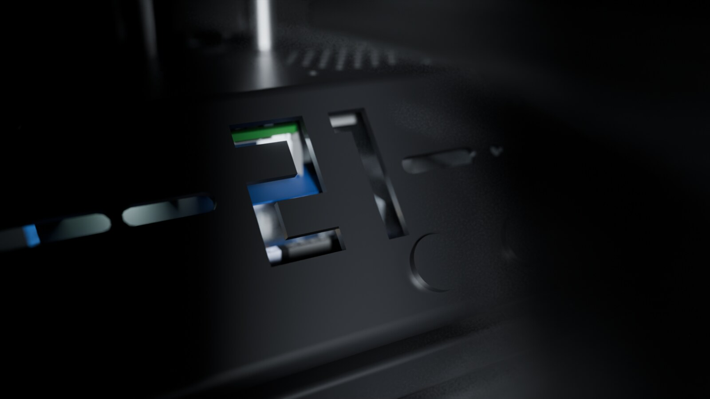
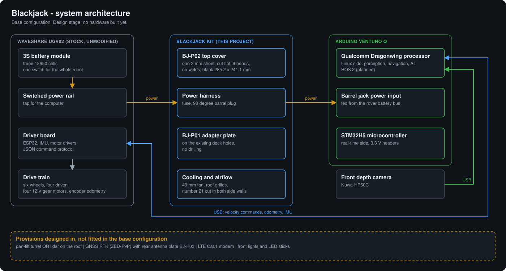
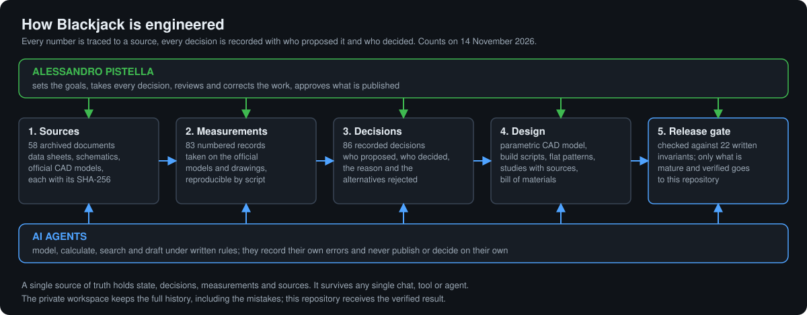

  

# Blackjack Rover

**An open ROS 2 rover platform for the Arduino VENTUNO Q and its Qualcomm Dragonwing IQ8 processor, built on a stock Waveshare UGV02 chassis and engineered in the open.**

I wanted to put the Arduino VENTUNO Q on wheels. The board pairs a Qualcomm Dragonwing IQ8 (QCS8275) processor running Linux with an STMicroelectronics STM32H5 microcontroller: one side for perception, navigation and edge AI, the other for real-time control. I looked for a platform to carry it and found none that really convinced me. So I am building one.

Blackjack is that platform, and this repository is the engineering record of how it gets made: the design, the studies, the decisions and, as they arrive, the drawings and the code.

## Why this combination

**Arduino VENTUNO Q, with Qualcomm Dragonwing inside.** Two processors on one board is the interesting part for a mobile robot: the Qualcomm Dragonwing IQ8 side runs Linux and is meant to carry ROS 2, the vision workload and on-device AI, the STM32 side is there for hard real-time work. Blackjack is designed to use both: first the standard ROS 2 tools, then a study on moving motor control to the microcontroller.

**Waveshare UGV02.** A compact metal chassis with six wheels, four of them driven, its own driver board and a 3S battery module, sold with official CAD models and documentation. It is a solid, well documented base. Blackjack does not modify it: the kit is designed to bolt to the holes that are already in the deck.

**The result.** A set of bent sheet-metal parts and a wiring harness that turn a stock UGV02 into a home for the VENTUNO Q, with room for a depth camera, a pan-tilt turret or a lidar, GNSS RTK and a cellular modem.

## The design

  

- **One sheet, no welds.** The top cover is a single 2 mm sheet, laser cut flat and then bent: 9 bends, flat blank 285.2 x 241.1 mm. Every hole and every cut-out is drawn on the flat sheet, so the part can be made by any shop with a laser and a press brake. [Why, and the rules it imposes](docs/DESIGN_RATIONALE.md#one-sheet-no-welds).
- **Nothing drilled in the chassis.** The adapter plate is designed around the existing holes of the UGV02 deck. [Why](docs/DESIGN_RATIONALE.md#nothing-drilled-in-the-chassis).
- **One switch for the whole robot.** The VENTUNO Q is fed from the rover battery bus through a fused line and a 90 degree barrel plug. The [power supply study](studies/BJ-STU-001_power_supply_study.md) shows how that was reached; the [rationale](docs/DESIGN_RATIONALE.md#one-switch-for-the-whole-robot) gives the trade-off.
- **Cooling by design.** A 40 mm fan, grilles on the roof, and the number 21 cut through both side walls: it is the name of the board, it is the game the rover is named after, and it is also an air path. [The reasoning](docs/DESIGN_RATIONALE.md#cooling-by-design).
- **Room to grow.** The cover carries the mounting patterns for a pan-tilt turret or a lidar, and for the antennas. These are designed in and stay unfitted in the base configuration. [How the options share the roof](docs/DESIGN_RATIONALE.md#room-to-grow).

  

## Architecture

  

| Block | What it is |
|---|---|
| Chassis | Waveshare UGV02, stock: driver board with IMU, four 12 V gear motors, 3S battery module |
| Computer | Arduino VENTUNO Q: Qualcomm Dragonwing IQ8 running Linux, STM32H5 for real-time control |
| Top cover BJ-P02 | one 2 mm sheet, laser cut and bent, 9 bends |
| Adapter plate BJ-P01 | 2 mm sheet on the existing deck holes |
| Rear antenna plate BJ-P03 | 2 mm bent sheet, ground plane for the GNSS antenna, flat blank 154.0 x 129.0 mm |
| Power | fused tap on the switched battery rail, 90 degree barrel plug ([study](studies/BJ-STU-001_power_supply_study.md)) |
| Vision | front depth camera; pan-tilt turret or lidar on the roof as options |
| Software | ROS 2 on the Linux side of the VENTUNO Q, standard navigation tools |

## How it is engineered

  

The rover is half of the project. The other half is the method.

- **Every number has an origin.** Data sheets, schematics and official CAD models are archived with their checksum. A value is either read from one of them or measured, and the record says which.
- **Every decision is written down**, with who proposed it, who took it, why, and what was rejected.
- **AI agents do a large share of the work**, and this is stated plainly rather than hidden. They model, calculate, search and draft, under written rules they cannot override. They decide nothing and publish nothing. I set the goals, take the decisions and correct the work, and the corrections are recorded too, including the mistakes.
- **What is published is what has been verified.** The working material lives in a private workspace. This repository receives a part only when it is mature and checked.

On 14 November 2026 the record holds 86 decisions, 83 measurement records and 58 archived sources, checked against 23 written invariants.

### The rules the work runs on

The agents are not the method. The method is the set of rules I imposed on them and on myself:

1. **One source of truth**, outside any chat or tool. It survives the loss of any single session.
2. **Separate roles**: lead, mechanics, electronics, software, communication. Each has its own area; work for another role is handed over in writing.
3. **Written invariants** that no agent can override. A conflict between an instruction and an invariant is declared, not settled quietly.
4. **Confirm before work**: what was understood, what will be produced, which files, which decisions are open. Then the work.
5. **Verify before stating**: on the files, on the archived sources, on the result itself. What cannot be verified is marked as not verified.
6. **Checked against its standard before it is called ready.** Every document, drawing and piece of code is compared with the reference standard of its kind and adapted. The check is recorded in the file, with the edition used and any deviation.
7. **Traceability**: every number to a source or a measurement, every decision to who proposed it and who took it.
8. **Errors stay on the record**, with their cause and their correction.
9. **State saved at least hourly**, so that someone else can pick the work up.
10. **A release gate** between the private workspace and this repository. I approve every release.
11. **The engineer decides.** Agents propose, calculate, model and draft.

### Standards

Referring my work to recognised standards is a habit I bring from my profession, and I required it here: every standard in this table was adopted at my request. The table covers the method and what the project produces. It says nothing about bought parts: this is a personal project, not a product for sale.

"Follows" means written to the standard and checked against it; it is not a third-party certification. A deviation is written down with its reason. Editions were checked on 14 November 2026.

| Kind of work | Standard followed |
|---|---|
| Quantities, units, dates | SI, ISO 80000-1:2022, ISO 8601-1:2019 |
| Requirements | ISO/IEC/IEEE 29148:2018, key words of BCP 14 (RFC 2119, RFC 8174) |
| Decisions | Architecture Decision Record format |
| Configuration and revisions | ISO 10007:2017 as guidance |
| Mechanical drawings | ISO 128 series, ISO 129-1:2018, ISO 5457, ISO 7200, general tolerances ISO 2768-1 class m |
| Sheet-metal flat patterns | 1:1 DXF with named cut and bend layers, bend data declared |
| Fasteners and threads | ISO designations in drawings and lists |
| Electrical diagrams | IEC 60617, IEC 61082-1:2014, IEC 81346-1:2022 |
| Cables and harness | IPC/WHMA-A-620 Revision F as workmanship reference |
| ROS 2 software | ROS 2 developer guide and code style, REP 103, REP 105, REP 144, REP 2004 |
| Python and C++ | PEP 8, PEP 257, type hints; ROS 2 C++ style |
| Microcontroller firmware | MISRA C:2025 as guideline, deviations recorded |
| Shell scripts | Google Shell Style Guide, ShellCheck |
| Commits, versions, change log | Conventional Commits 1.0.0, Semantic Versioning, Keep a Changelog 1.1.0 |
| Licences in files | SPDX identifiers, REUSE Specification 3.3 |
| Studies and reports | numbered sections and figures, references in IEEE style, sources archived with checksum |
| Guides and documentation | Diataxis, GitHub Flavored Markdown |

Each release states which rows it was checked against.

## What is in this repository

- this page
- the [design rationale](docs/DESIGN_RATIONALE.md): why each choice was made, and the decision behind it
- the [power supply study](studies/BJ-STU-001_power_supply_study.md)
- the [roadmap](ROADMAP.md): what comes next

## Follow the build

The build is documented while it happens, on video and here. Watch the repository to see each part land.

## Credits and licence

Designed and engineered by **Alessandro Pistella**.

If you use or show this work, please credit: *Blackjack Rover by Alessandro Pistella, github.com/alepistella/blackjack*.

Code is released under the Apache License 2.0; documents, drawings, flat patterns, studies and diagrams under Creative Commons Attribution 4.0; renderings and videos remain all rights reserved. In every case the condition is the credit above. Details in [LICENSING.md](LICENSING.md).

Arduino, VENTUNO, Qualcomm, Dragonwing, STM32, ROS and Waveshare are trademarks of their respective owners. This is an independent project, not affiliated with or endorsed by any of them. Their products are named here only to say what Blackjack is built for.

*Keep the smoke in, and have fun.*
