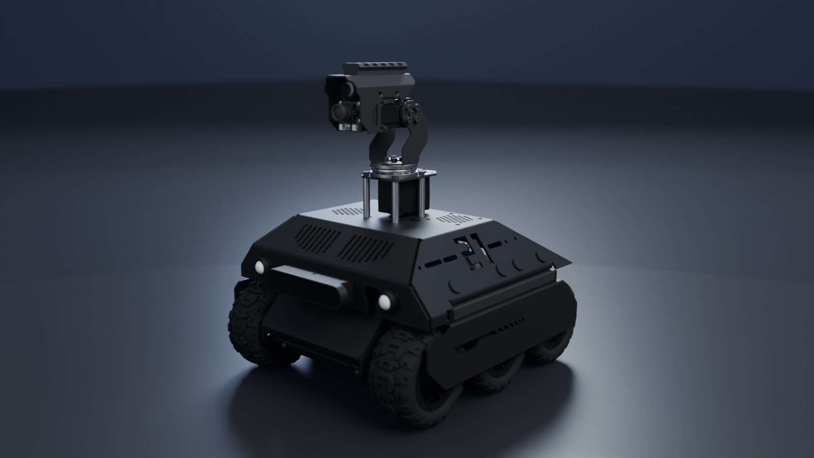
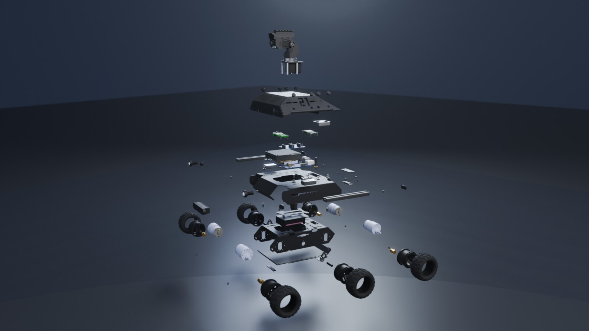
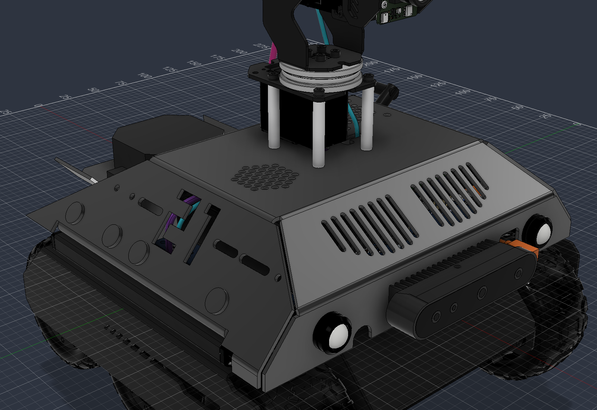
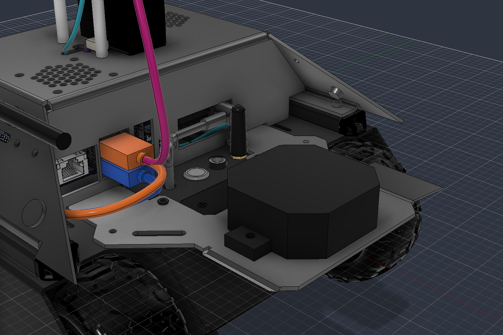
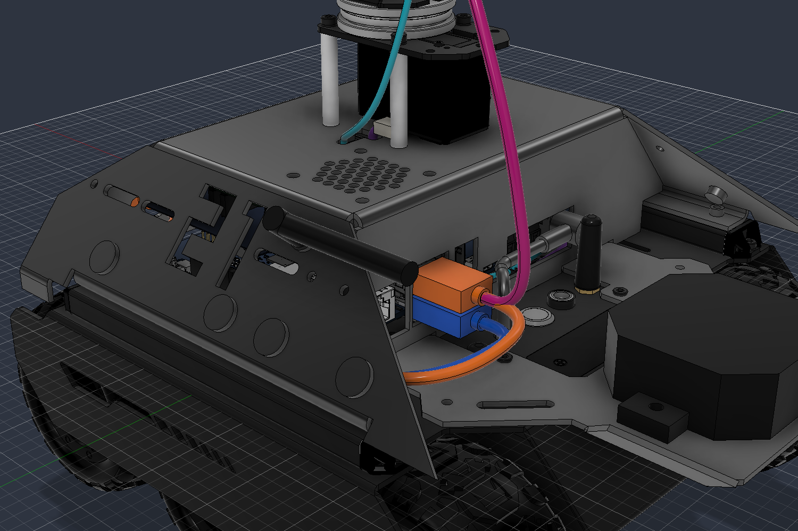
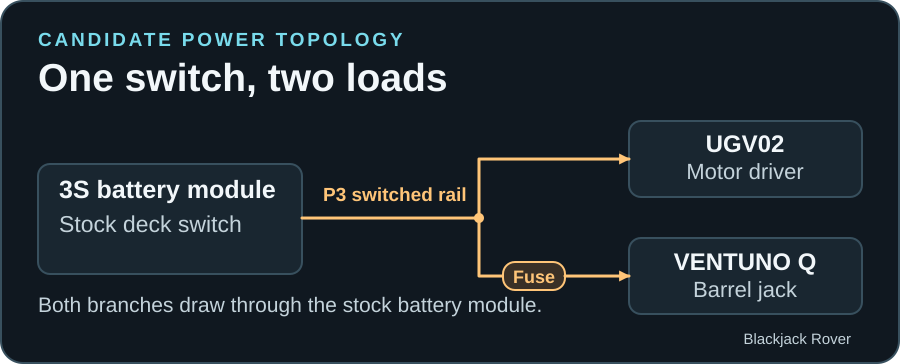

# Blackjack Rover

**An engineering project to explore what the Arduino VENTUNO Q and its onboard NPU can do on a ROS 2 rover.**

The Qualcomm Dragonwing IQ8 (QCS8275) brings Linux and a dedicated neural processing unit to a mobile platform, alongside an STM32H5 for real-time control. Blackjack uses a stock Waveshare UGV02 as the integration platform. The engineering question is how on-device inference fits alongside sensing, navigation and drive control when they share the rover’s power budget. [VENTUNO Q hardware reference](https://docs.arduino.cc/hardware/ventuno-q/).

The current design work covers mechanical packaging, the target ROS 2 architecture and a schematic-based power study. The UGV02 provides a drivetrain, motor controller and battery module, with manufacturer CAD for the mounting interface. Reusing that base focuses the initial integration on mounting the board, powering it from the rover battery and connecting ROS 2 to the motor controller. [Mounting rationale](docs/DESIGN_RATIONALE.md#nothing-drilled-in-the-chassis).

[System architecture](#system-architecture) · [Design rationale](docs/DESIGN_RATIONALE.md) · [Power supply study](studies/BJ-STU-001_power_supply_study.md) · [Build roadmap](ROADMAP.md)

*Blackjack Rover design render with the optional roof turret.*

## System architecture

Bring-up starts with the stock UGV02 drive electronics and the front depth camera. The first mechanical build already provides for GNSS RTK and LTE, whose commissioning follows the base checks. The VENTUNO Q is the target host for the robotics software and the USB serial interface to the motor controller. Keeping that boundary explicit makes it possible to bring up and diagnose the drive interface before introducing navigation.

**Host and base interface.** The software design targets Ubuntu, ROS 2 Jazzy and the Qualcomm Intelligent Robotics SDK on the Dragonwing IQ8. The base node is designed to translate velocity commands into the UGV02 controller’s JSON protocol over USB serial. Its design uses wheel encoder feedback for odometry and publishes IMU data from the controller. Wheel slip during skid steering makes odometry accuracy a validation item, particularly in turns. This gives teleoperation and navigation a common drive interface, with the chassis protocol contained in the base node.

**Perception and compute.** The front depth camera supplies range data over USB. Checking that stream separately from navigation makes it possible to distinguish a sensor or driver fault from a mapping or localisation fault. The first workload selected for the NPU is camera-based object detection as a ROS 2 node. To characterise it on the rover, the test plan calls for recording the model and runtime configuration, latency from image receipt to detection publication, and board input power with the drive stack running. [Bring-up sequence and extensions](ROADMAP.md).

**Positioning and connectivity.** When positioning is commissioned, the ZED-F9P computes the RTK position. Linux uses the SIM7672E LTE connection to fetch corrections from an NTRIP caster and forwards RTCM data to the receiver. The real-time experiment uses the receiver’s time pulse as a hardware timing reference for motion measurements on the STM32H5. A local IMU supplies the measurements for the separate heading correction loop. [RTK and LTE bring-up](ROADMAP.md#rtk-and-lte-bring-up) · [STM32H5 heading control](ROADMAP.md#stm32h5-heading-control).

## Mechanical integration

The adapter uses mounting points already present in the UGV02 deck. Their positions come from the manufacturer’s CAD, so the mounting interface is defined against the chassis geometry and the installation is reversible. [Adapter design rationale](docs/DESIGN_RATIONALE.md#nothing-drilled-in-the-chassis).

The enclosure is developed from a single 2 mm sheet with nine bends and a flat blank of 285.2 × 241.1 mm. A single blank avoids welded joints and keeps fabrication to laser cutting and press brake operations. That production route constrains the geometry. The openings must lie in the plane of the blank, the unfolded panels must fit without overlap, and adjacent panels must clear one another at bends. [Sheet-metal design rationale](docs/DESIGN_RATIONALE.md#one-sheet-no-welds).

The board has its own heatsink and fan, and the enclosure needs a path for that heat to leave the bay. A dedicated 40 mm fan exchanges air with the outside through roof grilles and the **21** cut into the side panels. [Cooling layout](docs/DESIGN_RATIONALE.md#cooling-by-design).

| Roof ventilation | Side-panel opening |
| --- | --- |
|  |  |
| The perforations provide a path for air exchange through the roof. | The cutout lets air pass through the side panel. |

A common mounting centre lets a turret and a lidar share one roof layout as alternatives. CAD already includes the **BJ-P03 rear plate** and its ground-plane provision for the GNSS antenna, and the **LTE antenna opening in the BJ-P02 cover**. Building in those interfaces now lets positioning and connectivity be commissioned after the base works using the same deck and enclosure. [Accessory interfaces](docs/DESIGN_RATIONALE.md#room-to-grow).

| Rear GNSS antenna | Side LTE antenna |
| --- | --- |
|  |  |
| The antenna sits on BJ-P03 behind the deck. | The antenna passes through BJ-P02 and folds back along the side panel. |

## Electrical design and bench verification

One switch must control power to both the computer and the drivetrain. Tapping the switched rail is the simplest of the four architectures compared in the study because it keeps the stock switching stage. Both loads would then pass through the battery module’s P3 output. The design also needs to account for how the board behaves at the voltages available on a 3S bus. Arduino lists 12–24 V for the barrel input in its connector table and discusses operation below 12 V subject to the available input power. [Switching alternatives](studies/BJ-STU-001_power_supply_study.md#49-the-rover-switch) · [VENTUNO Q power inputs](studies/BJ-STU-001_power_supply_study.md#46-ventuno-q-power-inputs).

The study uses a 33 W peak from an Arduino reference workload as a design case. At 11.1 V, the board alone would draw about 2.97 A before adding the motor load. Waveshare publishes 2 A for the retail module’s battery output, and the installed module revision must be identified before applying that rating to the rover. The shared rail is a candidate topology. Retaining it depends on the confirmed module ratings and measurements of the combined load. [Current budget](studies/BJ-STU-001_power_supply_study.md#5-current-budget) · [Bench test plan](studies/BJ-STU-001_power_supply_study.md#7-bench-test-plan).

## Engineering standards and traceability

Each deliverable has a reference appropriate to its discipline. Before release, I review the work against that reference and record the edition used and the reason for any deviation. Requirements have identifiers so a design decision and its verification can be traced back to the same requirement. For example, REQ-MEC-001 calls for a chassis without irreversible modifications. The adapter reuses the factory mounting holes, and the fit check compares that interface against the physical deck.

| Discipline | Reference | Application |
| --- | --- | --- |
| Requirements | [ISO/IEC/IEEE 29148](https://www.iso.org/standard/72089.html) | Write requirements that can be checked by inspection, analysis or test. |
| Mechanical drawings | [ISO 129-1](https://www.iso.org/standard/64007.html) | Define how dimensions and tolerances are presented on fabrication drawings. |
| Electrical documentation | [IEC 60617](https://webstore.iec.ch/en/publication/2723) | Use standard graphical symbols in electrical schematics. |
| Harness workmanship | IPC/WHMA-A-620 | Use a reference for wire terminations, crimps and workmanship inspection. |
| ROS 2 interfaces | [REP 103](https://github.com/ros-infrastructure/rep/blob/master/rep-0103.rst) and [REP 105](https://github.com/ros-infrastructure/rep/blob/master/rep-0105.rst) | Establish units, axis conventions and the roles of frames such as `base_link` and `odom`. |

The engineering record distinguishes manufacturer data, CAD measurements, calculations and physical test results. I set the requirements, make the engineering decisions and review releases. I use AI tools to assist with modelling, analysis and documentation.

## Related ROS 2 work

In the separate **dum-e** project I investigated reactive navigation with a small neural network in ROS 2 and Gazebo. A language model wrote the network weights directly, then used recorded runs and activation traces to revise them. During execution, the network converted lidar inputs into motion commands. The language model’s role was in development.

One recorded comparison starts both revisions from the same simulated pose. The earlier controller circles until timeout. The revised controller searches for a wall, follows it and crosses the doorway. The study documents the paired trajectories and the controller revision. It also includes a Nav2 reference configuration for selected scenarios and the individual run records. [A robot controller, written in weights](https://alepistella.github.io/dum-e/written-in-weights.html) · [Reproduction guide](https://alepistella.github.io/dum-e/reproduce.html) · [Recorded results](https://alepistella.github.io/dum-e/results.html).

## Licensing

See [licensing and attribution](LICENSING.md) for the terms that apply to documentation, code and renderings.
