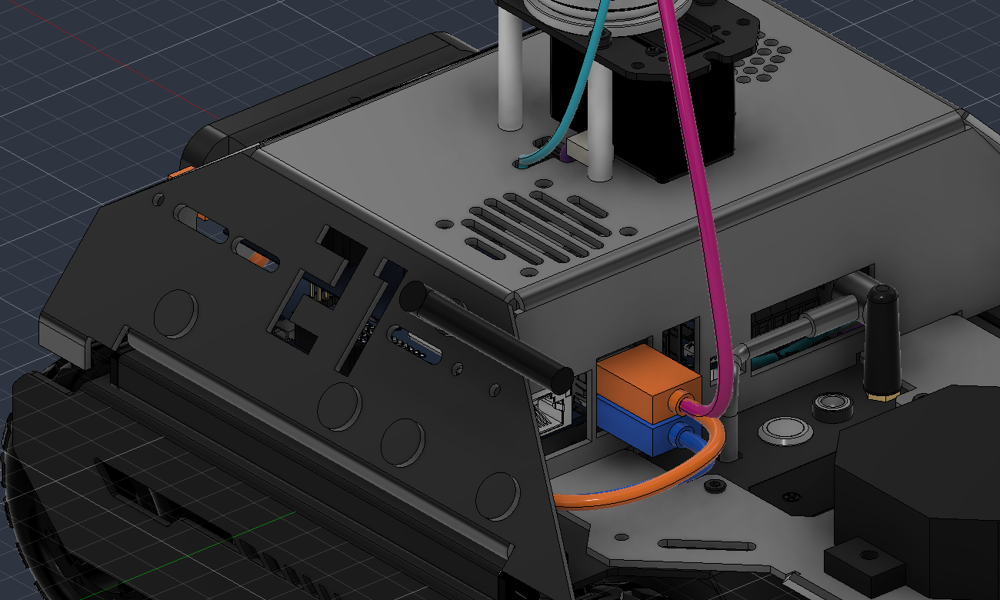
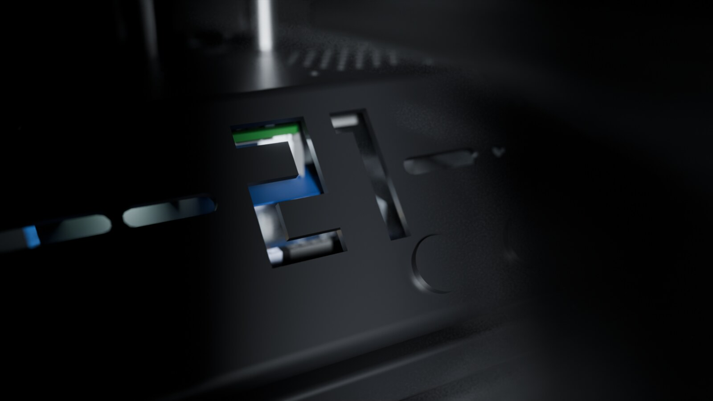
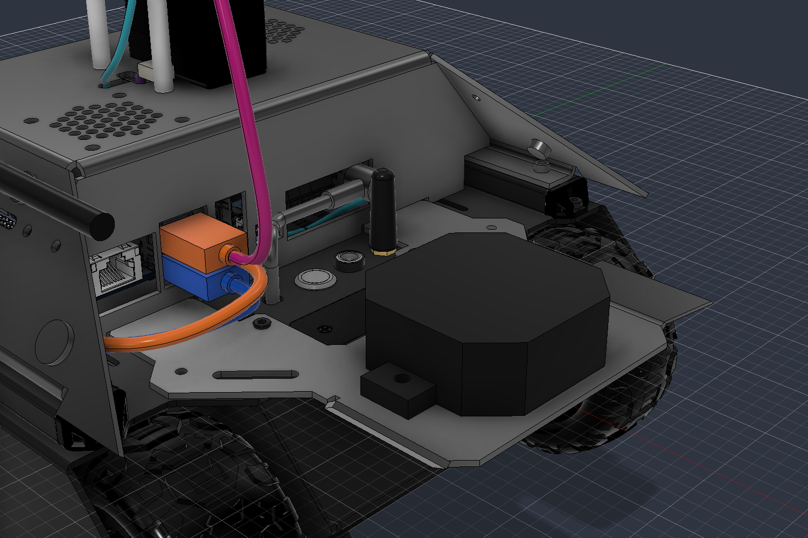
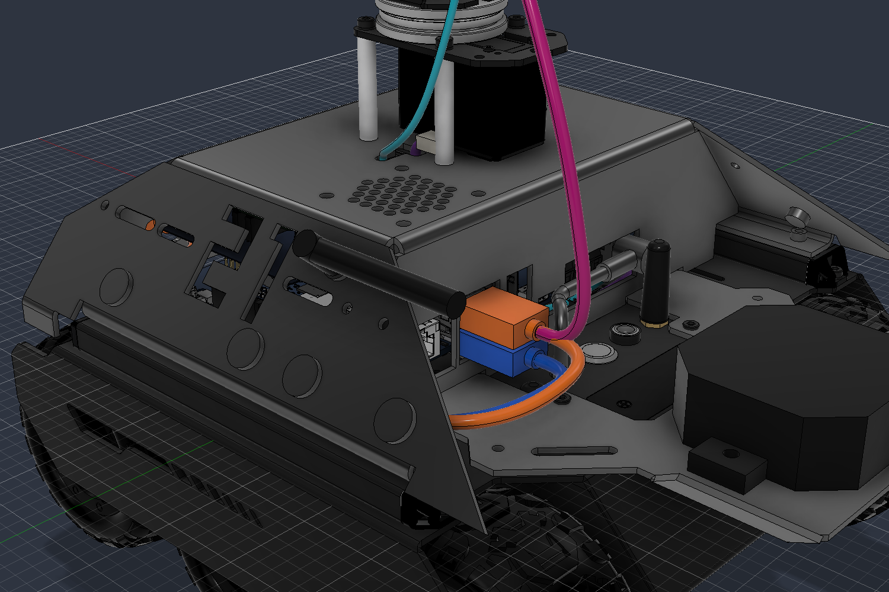

# Design rationale

This record explains the requirements, alternatives and design constraints behind the main integration choices. The decision identifiers refer to the project record.

## One sheet, no welds

**The choice.** Each sheet-metal part is one planar sheet, laser cut flat and then bent. No welds, no joints between panels.

**Why.** Starting from a single blank removes weld fixtures and weld distortion from the fabrication process. The flat pattern still depends on the selected material, tooling and bend allowances. The fabrication check is whether the shop can form the bends in sequence and whether the finished part fits the chassis.

**What it imposes on the design.** Three written rules that the model is checked against:

- every hole and cut-out is drawn in the plane of its own face, so that it can be cut before bending;
- each panel has one parent bend in the development, and the flat pattern has no overlapping panels;
- the CAD design allows at least 1.5 mm where one panel edge ends near an adjacent bend. Shop tooling and the fabricated part govern the final clearance check.

**Record.** Rear fins as flat fins instead of closed volumes, "no welding of sheets": D-041, 12 November 2026. Bend clearances: D-056. The cover is a 2 mm sheet with 9 bends and a flat blank of 285.2 x 241.1 mm, developed from the CAD model.

## Nothing drilled in the chassis

**The choice.** The kit bolts to the holes that already exist in the deck of the Waveshare UGV02, through an adapter plate.

**Why.** Asking a builder to drill and tap a new chassis raises the bar for fitting the kit and removes the way back to stock. The Waveshare CAD model supplies the nominal hole positions. The fit check compares the hole pattern and thread engagement with the physical deck.

**Record.** The model carries two ways of fixing the board: holes drilled and tapped in the deck, and a bolt-on adapter plate on the existing holes, with one cover that fits both. The plate is what lets the kit be fitted without drilling: D-019, 12 November 2026.

## One switch for the whole robot

A shared switch is a requirement for the board and drive electronics. The candidate design takes the board feed from the stock switched rail through a fused branch and a right-angle barrel plug. This keeps one switching stage and reduces the space required behind the board.

The candidate concentrates both loads at P3. Its suitability depends on the installed module's output rating, the board's input limits and the combined load measurements. The study compares separate switching stages and a dedicated switch as alternatives. [Power design decision](../studies/BJ-STU-001_power_supply_study.md#91-decision) · [Bench test plan](../studies/BJ-STU-001_power_supply_study.md#7-bench-test-plan). Decision D-079, 14 November 2026.

## Cooling by design

The board has its own heatsink and fan. The enclosure has to replace the warm air around that heatsink with outside air. The first calculation used the perforated cover alone: at 15 W and in shade, buoyancy through the openings left the bay air about 50 K above ambient. Adding a 40 mm bay fan reduced that rise to about 11 K, but the direct-sun case at 25 W left little room for a hot day. In that case the model reached the 60 °C bay limit at 27 °C outside.

Replacing the 37 holes immediately above the fan with seven slots increased the free area from 356 to 667 mm² without changing the fan or its mount. The base calculation gives 5.2 m³/h through the slotted cover, up from 3.5 m³/h. At 25 W in direct sun, it puts the outside temperature at the bay limit at 38 °C (33 °C using the lower fan curve). That gain justified changing the grille. The temperature margin and the absence of throttling still need to be checked on the built rover.

| Roof ventilation | Side-panel opening |
| --- | --- |
|  |  |
| The 40 mm bay fan exhausts through seven roof slots. | The side cutout is one of the air inlets. |

The fan exhausts through the slotted roof vent. Air can enter through the separate perforated grille above the heatsink, the front grille and the **21** cutouts. Decisions D-093 and D-094 record the grille change and fan direction. [Ventilation study and hardware test plan](../studies/BJ-STU-002_bay_ventilation_study.md).

## Room to grow

**The choice.** The roof carries the mounting patterns of both a lidar and a pan-tilt turret on one shared centre; the cover and a rear plate carry the antennas. The first mechanical build includes the designed BJ-P03 rear plate for the GNSS antenna and the LTE antenna opening already cut into the BJ-P02 CAD model. The roof accepts either accessory in a separate configuration.

| Rear GNSS antenna | Side LTE antenna |
| --- | --- |
|  |  |
| The antenna sits on BJ-P03 behind the deck. | The antenna passes through BJ-P02 and folds back along the side panel. |

**Why.** The initial perception work uses the front depth camera to keep the sensor configuration small. A shared centre reserves a single roof location for either accessory. Defining the antenna positions, ground-plane provision and cable routes with the first enclosure avoids a second metalwork revision when RTK and LTE are commissioned. The drive and camera are commissioned first, then positioning and connectivity are tested separately.

**Record.** Lidar or turret, never both: D-014. One shared mounting centre: D-064. Turret or front camera: D-069. Rear antenna plate and ground-plane provision: D-081. LTE antenna placement on the cover: D-082. CAD and flat patterns for both parts: RIL-083. First-build provisions and staged commissioning: D-092.
