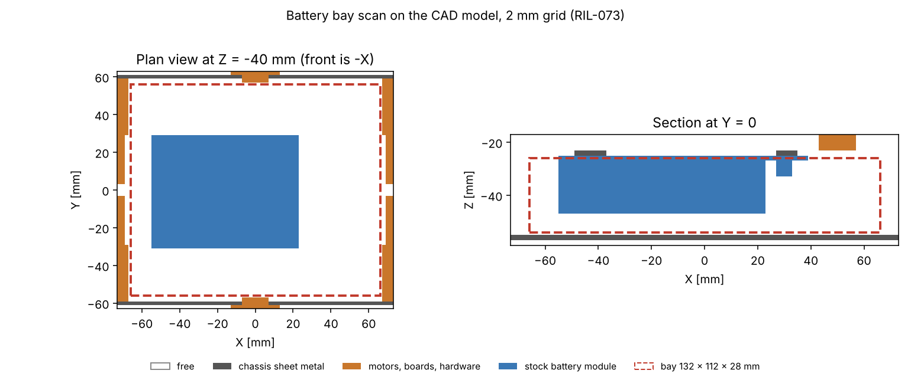
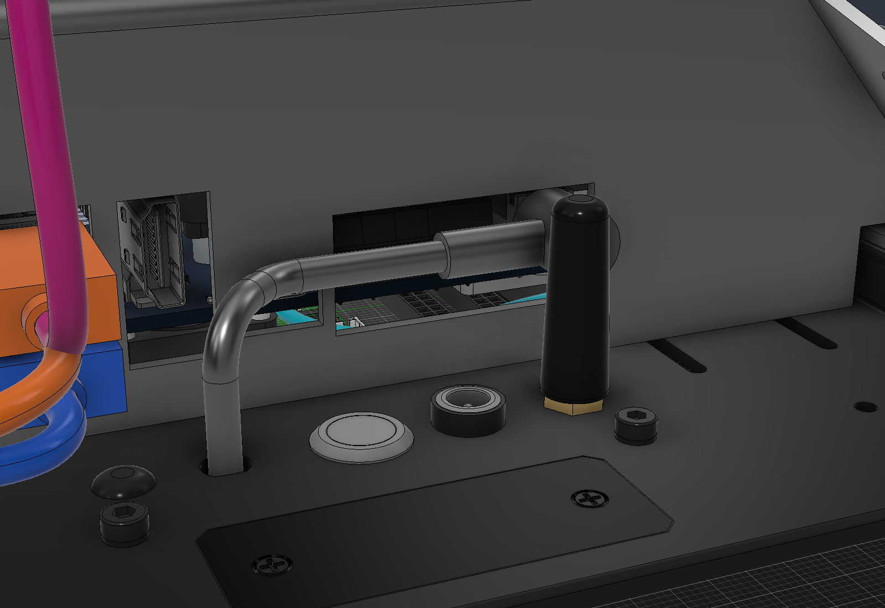

# BJ-STU-001 - Power supply study: battery module, driver board, VENTUNO Q

| | |
|---|---|
| Document | BJ-STU-001 |
| Revision | C |
| Date | 15 November 2026 |
| Project | Blackjack Rover: rover for the Arduino VENTUNO Q on a Waveshare UGV02 chassis |
| Licence | CC BY 4.0, credit: Blackjack Rover by Alessandro Pistella, github.com/alepistella/blackjack |
| Measurement records | RIL-004, RIL-011, RIL-057, RIL-072, RIL-073, RIL-074 |

This study compares four architectures for powering the VENTUNO Q and the drivetrain with one switch. The direct branch is the simplest candidate. The shared output rating and the board's behaviour below the published barrel-input range are the main constraints. The evidence consists of supplier documentation, schematic analysis and measurements from CAD.

## Contents

1. [Purpose and questions](#1-purpose-and-questions)
2. [Sources](#2-sources)
3. [Method and limits](#3-method-and-limits)
4. [Findings](#4-findings)
   - 4.1 [Who charges the battery](#41-who-charges-the-battery)
   - 4.2 [LiPo against Li-ion charging](#42-lipo-against-li-ion-charging)
   - 4.3 [Current capability of the battery module](#43-current-capability-of-the-battery-module)
   - 4.4 [Driver board power input](#44-driver-board-power-input)
   - 4.5 [How Waveshare powers a Raspberry Pi 5 in the same rover](#45-how-waveshare-powers-a-raspberry-pi-5-in-the-same-rover)
   - 4.6 [VENTUNO Q power inputs](#46-ventuno-q-power-inputs)
   - 4.7 [VENTUNO Q power control input](#47-ventuno-q-power-control-input)
   - 4.8 [VENTUNO Q consumption when off](#48-ventuno-q-consumption-when-off)
   - 4.9 [The rover switch](#49-the-rover-switch)
   - 4.10 [Battery bay](#410-battery-bay)
5. [Current budget](#5-current-budget)
6. [What the findings allow](#6-what-the-findings-allow)
7. [Bench test plan](#7-bench-test-plan)
8. [Note on third-party images](#8-note-on-third-party-images)
9. [Decision, ratings of the chosen parts, plug](#9-decision-ratings-of-the-chosen-parts-plug)

## 1. Purpose and questions

The stock UGV02 carries a battery module with three 18650 cells. Adding a VENTUNO Q changes the load on the shared battery output. The study examines the charging, switching and power interfaces against the proposed installation.

1. Who charges the battery, with which profile, actively or passively, and whether the charger can be replaced by a LiPo charger with the same footprint.
2. Whether the power path can carry the current we need.
3. Whether the driver board accepts the voltage of a 3S LiPo.
4. Whether the VENTUNO Q has an input for an external power switch, and whether the switch of the rover can drive it.
5. Whether a 3S LiPo can feed the VENTUNO Q directly, and what the board draws when it is off.
6. How much room there is under the deck for a battery.
7. Added on 14 November: how Waveshare powers a Raspberry Pi 5 in the same rover, since that board needs 5 V at 5 A.

## 2. Sources

The project archive records SHA-256 fingerprints for downloaded references. The table also identifies references consulted online. RIL and D identifiers refer to measurement and decision records.

| ID | Source | Used for |
|---|---|---|
| SRC-01 | [Arduino VENTUNO Q datasheet ABX00181](https://docs.arduino.cc/resources/datasheets/ABX00181-datasheet.pdf), 62 pages, "Modified: 12/11/2026" | ratings, power consumption, JCTL and JMISC pins, pushbutton |
| SRC-04 | [Arduino VENTUNO Q schematics ABX00181](https://docs.arduino.cc/resources/schematics/ABX00181-schematics.pdf), 71 sheets | sheet 50 "POWER", sheet 51 "POWER DCDC SOM" |
| SRC-09 | [Waveshare driver board schematic](https://files.waveshare.com/wiki/common/ROS_Driver_for_Robots.pdf), one sheet | driver board power input, 5 V converter |
| SRC-30 | [Waveshare UPS Module 3S schematic](https://files.waveshare.com/wiki/UPS%20Module%203S/Ups01.pdf), one sheet | battery module |
| SRC-W05 | [Waveshare General Driver for Robots](https://www.waveshare.com/wiki/General_Driver_for_Robots) (archived page) | input range, role of the 40-pin header |
| SRC-32 | Waveshare assembly video, https://www.youtube.com/watch?v=8wqPs7rNkJ4, two frames supplied by Alessandro on 14 November 2026 | position of the battery module, host mounting |
| SRC-N13 | Raspberry Pi Ltd, white paper "USB Power Delivery on Raspberry Pi 5" (read on the web, not archived) | powering a Raspberry Pi 5 from the GPIO header |
| CAD | Fusion document "Blackjack_B", milestone M3 | battery bay |

The identity of the battery module fitted in the UGV02 with the retail "UPS Module 3S" of SRC-30 is inferred (same four 2-pin connectors, same cell holder, same board size), not confirmed on the part: see RIL-057. The assembly video supports the location and layout (section 4.10). Confirm the part marking before using the retail module as the electrical reference.

## 3. Method and limits

- Schematics were rendered to images and read by eye, with text extraction to locate nets and part numbers. Part values quoted here are the ones printed on the sheets.
- Track widths, copper weight and connector contact ratings are not on any schematic. Where a limit depends on them, it is stated as unknown.
- Section 9 lists component ratings from datasheets. The assembled module also depends on its PCB, wiring, connector and thermal conditions.
- The battery bay was measured on the CAD model with a point grid (section 4.10). The body in the model is the UGV Rover body, which matches the UGV02 on the dimensions compared so far (RIL-006, RIL-009). The stock wiring is not modelled.

## 4. Findings

### 4.1 Who charges the battery

There is no charger integrated circuit on the battery module. The parts on the sheet are: INA219 (current and voltage monitor, address 0x41), eight AO4407A P-channel MOSFET, S-8254AA (protection for 3 cells in series), three HY2213-BB3A (cell balancing), three SI2302, SY8286 (5 V step-down converter), RT9193-33 (3.3 V regulator), NDC7002N (I2C level shifter).

The charge path is: connector P1 "INPUT", a 16 V 3 A resettable fuse, a reverse-protection MOSFET (M1), then the pack through the protection MOSFET. The module protects and balances; it does not regulate the charge. The constant-current constant-voltage profile is produced by the external 12.6 V adapter.

Balancing is passive: each HY2213 switches a 62 ohm resistor across its cell near full charge, about 68 mA at 4.2 V.

*Figure 1 (not reproduced here, see the cited source). Battery module, excerpt of SRC-30: input P1 with fuse and M1, shunt R2 (0.1 ohm) with INA219, protection S-8254AA with the MOSFET, balancing HY2213.*

The schematic places charge-profile regulation in the external adapter. The battery module provides protection and passive balancing.

### 4.2 LiPo against Li-ion charging

The study uses the documented stock battery arrangement. Any substitute pack requires a separate check against the selected cell and pack documentation for charge voltage and current, balancing, protection and mechanical fit. The number of cells in series alone does not establish charger compatibility.

### 4.3 Current capability of the battery module

All the current of the pack, charge and discharge, flows through R2: 0.1 ohm, 1%, size 2512. It is the shunt of the INA219.

| Current | Dissipation in R2 (I² x 0.1 ohm) | Voltage across R2 |
|---|---|---|
| 2.0 A | 0.40 W | 0.20 V |
| 3.16 A | 1.00 W | 0.32 V |
| 5.0 A | 2.50 W | 0.50 V |
| 6.0 A | 3.60 W | 0.60 V |

The INA219 full-scale shunt input is ±0.32 V at its widest setting (SRC-34). With a 0.1 Ω shunt, that corresponds to 3.2 A of measurement range. The schematic gives no power rating for R2. Continuous output capacity depends on the assembled module, including shunt dissipation, PCB heating, protection and the output connector. [INA219 datasheet](https://www.ti.com/lit/ds/symlink/ina219.pdf).

The output is switched by one MOSFET, M3, and leaves through connector P3 (XH2.54, 2 pins). Waveshare lists 2 A for the retail module's XH2.54 battery output. The link identifies the retail reference, pending identification of the module fitted to the rover. [Waveshare UPS Module 3S](https://www.waveshare.com/wiki/UPS_Module_3S#Interface_Definition). The overcurrent sense resistors are R21 and R22, 0.01 ohm 2512 each.

*Figure 2 (not reproduced here, see the cited source). Battery module, excerpt of SRC-30: M4 (ideal diode, marked OPTION), M3 (output switch), R39 1 M from gate to source, connector P4 "SWITCH" between the gate of M3 and ground, output P3 on net VBAT.*

### 4.4 Driver board power input

Input H2 is an XH2.54 2-pin connector (the sheet also notes a 5.5 x 2.1 jack on the same footprint). From there: M1 AO4407 as reverse-polarity protection, net DC_IN, shunt R21 0.01 ohm 1% 2512 2 W with INA219 at address 0x42, net VIN marked "6-12V".

On VIN sits an MP8759GD step-down converter, titled on the sheet "5V-5A" and "5V Power for RPi/Jetson nano", followed by M2 AO4407 as an ideal diode onto the 5 V rail of the 40-pin header.

*Figure 3 (not reproduced here, see the cited source). Driver board, excerpt of SRC-09: input H2, M1, shunt and INA219 (0x42), MP8759GD 5 V converter.*

The wiki of the board (SRC-W05) gives the input as "DC 7~13V", for a 2S or 3S lithium battery, and states that this input feeds the motors and the bus servos directly.

Answer to question 3: a 3S LiPo ranges from 9.0 V (empty) to 12.6 V (full), the same as a 3S 18650 pack, inside the 7 to 13 V of the board. Compatible. A 4S pack (16.8 V full) is outside the range, so the bus stays at 3S.

### 4.5 How Waveshare powers a Raspberry Pi 5 in the same rover

The assembly video (SRC-32) shows the host mounted on the driver board's 40-pin header, with no visible USB-C supply cable.

That matches the documents:

- SRC-W05: the 40-pin header is "for connecting to Raspberry Pi, Jetson Nano, and other host computers, communicating via serial port or IIC, and powering the host computer"; item 7 of the board is the "DC-DC 5V voltage regulator circuit: power supply for host computers such as Raspberry Pi or Jetson nano".
- SRC-09: the converter is titled "5V-5A" and "5V Power for RPi/Jetson nano" (figure 3).

A Raspberry Pi 5 can be powered through the 5 V pins of its header. Raspberry Pi's own white paper on USB Power Delivery (SRC-N13) has a chapter on bypassing the USB-C negotiation: a user "may not wish to employ the USB-C power socket, preferring instead to supply power via the GPIO", and sets `PSU_MAX_CURRENT=5000` or `usb_max_current_enable=1` so that the board does not limit its USB ports. The limit of the header route is the lack of negotiation, not the pins.

*Figure 4 (not reproduced here, see the cited source). Frame from SRC-32: the host is lifted off; below it the stacked boards on brass standoffs with the 40-pin riser on the left. No USB-C power cable is visible.*

The stock design shows how a host and drivetrain can share a supply topology. The 25 W converter figure describes the nominal converter output. The video provides evidence for the connection arrangement. Neither source reports the actual host current or qualifies the retail module for a load above its documented rating.

### 4.6 VENTUNO Q power inputs

From SRC-01, chapters 3 and 4.3, and SRC-04, sheet 50:

| Input | Datasheet range | Datasheet maximum current |
|---|---|---|
| USB-C, Power Delivery only | 9, 15 or 20 V profile | 3 A |
| Barrel jack 5.5 x 2.1 mm | 12 to 24 V | 5 A |
| Screw terminal | 7 to 24 V | 10 A |

On the schematic the barrel jack J5 and the screw terminal J8 are the same net, "7V-24V". The datasheet separately discusses the board's 7 V startup floor and the power available through the jack at lower voltages. Its connector table specifies 12-24 V for the barrel jack. The common net explains the circuit arrangement. Operation down to the proposed low end of the 3S bus remains a design question under load.

*Figure 5 (not reproduced here, see the cited source). VENTUNO Q, excerpt of SRC-04 sheet 50: barrel jack J5 and screw terminal J8 on the same net, TVS D5, power switch U15 (KTS1900) with MOSFET Q1 and Q2.*

Power available through the jack at its 5 A limit, over the range of a 3S pack:

| Bus voltage | Power at 5 A |
|---|---|
| 9.0 V (low-voltage design case) | 45 W |
| 11.1 V (nominal) | 55.5 W |
| 12.6 V (pack full) | 63 W |

Measured consumption of the board, SRC-01 section 3.4.1, at 12 V: 7.07 W average while booting, 13.5 W average and 24.6 W maximum in the "Edge AI Assistant" example, 14.7 W average and 33.0 W maximum in the "Smart Mirror" example (with a USB camera, a USB headset and an HDMI display). The highest peak recorded by Arduino on any input is 36.6 W, at 24 V.

After the input, each path passes an ideal-diode power switch (KTS1900 with two SQS414CENW MOSFET), then a 2 milliohm shunt with an INA232 that measures the total input current of the board.

The direct barrel feed is a candidate. The comparison uses the available jack power and reference workloads to estimate demand. The selected installed connector pair, voltage at the board under transients and shared module capacity determine which part of the proposed bus range is usable.

### 4.7 VENTUNO Q power control input

The board has a power-disable input. It is the net POWER_DISABLE_7-24V, brought out on JCTL pin 10 (named POWER_SWITCH_DISABLE_N) and on JMISC pin 87.

On sheet 51 the net is the EN pin of the MPQ4371 step-down converters that make the 3.3 V rail of the system-on-module, with 100 k to the input and 24 k to ground. The pin therefore rests at 24/124 = 0.194 of the input voltage:

| Input voltage | Voltage on the pin at rest |
|---|---|
| 9.0 V | 1.74 V |
| 12.6 V | 2.44 V |
| 24.0 V | 4.65 V |

SRC-01, chapter 9.5: "pull below 0.85 V to disable main power, keep above 1 V for normal operation, and do not exceed 5 V externally"; the pin is not protected by a TVS; a cold reboot is done by pulling it low through an open-drain stage.

*Figure 6 (not reproduced here, see the cited source). VENTUNO Q, excerpt of SRC-04 sheet 50: shunt R229 with INA232, net POWER_DISABLE_7-24V into the DISABLE input of the SoM converters.*

*Figure 7 (not reproduced here, see the cited source). VENTUNO Q, excerpt of SRC-04 sheet 51: DISABLE on the EN pin of the converter, R117 100 k to INPUT, R357 24 k to ground.*

The board starts by itself when power is applied (SRC-01, chapter 11.4). The on-board vertical pushbutton is a momentary button read by the microcontroller: a single press asks for a shutdown, a press of 10 seconds shuts Linux down and "the board will remain off until power is disconnected and reconnected". It is a software shutdown request, not a power switch.

Answer to question 4, first part: yes, there is an input that switches the main power of the board off, active low.

### 4.8 VENTUNO Q consumption when off

Not specified. The datasheet gives no figure for the board with the disable pin low, nor after a shutdown.

What the schematic shows: with the pin low the converters of the system-on-module are disabled, but the input power switch, the resistor dividers on the input and the USB-C controller stay supplied. SRC-01: the CYPD6129 "remains always powered via a dedicated buck converter (LMR51440) supplied from any connected power source".

Answer to question 5, second part: the board has no documented true power-off while a supply is connected. The residual current must be measured before the board is left connected to a battery upstream of the rover switch.

### 4.9 The rover switch

From SRC-30 (figure 2): connector P4 "SWITCH" has pin 2 on the gate of M3 and pin 1 on ground; R39, 1 M, holds the gate at the source voltage. Closing the switch turns M3 on. The switch carries only the gate signal, not the load current.

M3 feeds net VBAT, and VBAT feeds both the battery-voltage output P3 and the 5 V converter. With the switch open everything downstream of the pack is off. There is no output upstream of the switch.

The switch on the deck is named "自锁开关" (self-locking switch) in the Waveshare CAD model, and the kit of the retail module lists a "self lock button switch". By the documents it is a latching switch, not a momentary one. To confirm on the part.

Answer to question 4, second part: the signal of the rover switch is not directly compatible with the disable pin of the VENTUNO Q, for two reasons:

- the sense is opposite: the closed switch means "rover on", while a low level on the pin means "board off";
- with the switch open, its live side rises to the battery voltage through 1 M.

One switch for the whole rover is still possible in four ways:

| Way | What is added | Board off means | Current through the battery module |
|---|---|---|---|
| A. Feed the board from the switched rail (downstream of M3) | a branch cable | no supply at all | rover plus board |
| B. Second MOSFET for the board line, gate on the same switch node | one P-MOSFET, direct line from the pack | no supply at all | rover only |
| C. Inverter between the switched rail and the disable pin | two small N-MOSFET, direct line from the pack | residual current of 4.8 | rover only |
| D. Two-pole latching switch | a different switch, direct line from the pack | residual current of 4.8 | rover only |

### 4.10 Battery bay

A frame of SRC-32 confirms where the battery module sits: under the chassis, between the four motors, reached by removing the bottom plate, with the cell holder facing down.

*Figure 8 (not reproduced here, see the cited source). Frame from SRC-32: three-cell holder between the motors; connectors on one end of the board, a button, indicator LEDs and a 2 x 3 header on the other end; bottom plate on the right.*

The bay was measured on the CAD model with a grid of points every 2 mm, testing each point against the sheet-metal bodies and against the bounding boxes of all other parts (script and data: `evidence/RIL-073_battery_bay_scan_2mm.json`).

| Case | Largest free box (X x Y x Z) | Position in the rover frame |
|---|---|---|
| Stock module removed | 132 x 112 x 28 mm (414 cm3) | X -66..66, Y -56..56, Z -54..-26 |
| Stock module kept | 132 x 24 x 36 mm, one side channel | X -66..66, Y -56..-32, Z -54..-18 |

The limits of the bay are the motor bodies (X at 67 mm each side), the side walls of the tub (outer faces at Y 60.0 mm), the floor of the tub, and the plate that carries the driver board (underside at Z -24.6 mm), which stays.

*Figure 9. Scan of the bay on the CAD model. Left: plan view at Z -40 mm. Right: longitudinal section on the centre line. Dashed: the largest free box with the stock module removed.*

What fits in 132 x 112 x 28 mm, with no allowance for holders, wiring or protection board: twelve 18650 cells (18.5 x 65 mm) in one layer, two in length (130 mm) and six across (111 mm), that is a 3S4P pack. Two 21700 cells in length (140 mm) do not fit.

Resolution of the figures: 2 mm. The stock wiring visible in figure 8 takes part of the space around the module and is not in the model.

## 5. Current budget

Battery-side current of the VENTUNO Q fed directly at bus voltage (power divided by voltage, no converter in between):

| Condition | Power (SRC-01, 12 V table) | At 12.6 V | At 11.1 V | At 9.0 V |
|---|---|---|---|---|
| Average, Edge AI Assistant | 13.5 W | 1.07 A | 1.22 A | 1.50 A |
| Average, Smart Mirror | 14.7 W | 1.17 A | 1.32 A | 1.63 A |
| Peak, Smart Mirror | 33.0 W | 2.62 A | 2.97 A | 3.67 A |

For comparison, the stock host supply: 5 V at 5 A is 25 W at the output of the converter, which is at least 1.98 A at 12.6 V and at least 2.78 A at 9.0 V on the battery side, before the losses of the converter.

The rover's own current (four motors, driver board, servos, lights) is not in any archived source as a measured figure.

The Raspberry Pi comparison uses nominal converter capacity. The VENTUNO Q columns are estimates based on Arduino reference workloads and assume constant power across the three bus voltages. Actual rover inference and motor loads require their own measurements.

## 6. What the findings allow

The evidence supports the following conclusions for the candidate architectures.

1. A direct barrel feed removes a converter from the branch. Qualification depends on connector fit and the board's voltage and power limits (section 4.6).
2. A single switch for the whole rover needs no added electronics if the board is fed from the switched rail (way A of section 4.9). The cost is that the board's current passes the battery module, as the host's current does in the stock rover.
3. The 33 W reference case alone exceeds the retail module's documented 2 A output throughout the three voltage cases. Identify the installed module and apply its ratings to the combined load before retaining the stock path.
4. The CAD envelope provides a geometric upper bound for evaluating a larger pack. Packaging, protection, charging compatibility and the power path require a separate design review (section 4.10).
5. The VENTUNO Q measures its own input current (INA232), and the driver board measures its own (INA219 at 0x42). These monitors can provide branch telemetry within their ranges. Bench instrumentation is needed to capture the shared output and fast transients.

## 7. Bench test plan

Characterise the base configuration first. Repeat the load checks with RTK and LTE active before commissioning positioning and connectivity, including modem transmission events. The first enclosure already incorporates the antenna mounting provisions.

| Item | What is measured |
|---|---|
| Battery module identity | part marking, connectors P1..P4, value and size of the shunt |
| Deck switch | latching or momentary, contacts, hole size |
| Drivetrain load | Record idle, driving and controlled motor transients after confirming the permissible voltage and load limits. |
| VENTUNO Q load | Characterise boot and the selected inference workload on a supply within the board's published connector range. Use those traces to evaluate the candidate rail. |
| Barrel interface | Identify the fitted jack. Check plug engagement and applicable contact ratings for the pair. |
| VENTUNO Q residual current | disable pin low; after a 10 s press; after a shutdown from Linux |
| Combined load | Measure shared output current and board input voltage during defined motor and inference events. Compare the traces with the installed hardware ratings and record any supply drop or reset. |
| Thermal behaviour | Record the connector and module temperatures during sustained load at a documented ambient temperature. Compare with applicable component and assembly limits. |
| Charge | Adapter label, compatibility with the selected stock cells and module temperature during charging. |
| Driver board switch | the wiki lists an on-board switch for the external supply: what it switches |
| Battery bay | real free dimensions with the stock wiring |

## 8. Note on third-party images

Figures 1, 2, 3, 5, 6 and 7 are excerpts of schematics published by Waveshare and by Arduino; figures 4 and 8 are frames of a Waveshare video. They are not reproduced in this public edition: each caption names the document, the sheet and the nets, so that the reader can open the original. Figures 9 and 10 are our own.

## 9. Decision, ratings of the chosen parts, plug

Every value below is copied from a data sheet kept in the project archive with its SHA-256. The data sheets belong to their manufacturers; they are cited here, not reproduced. Record: RIL-075.

### 9.1 Decision

D-079 records the candidate for bench evaluation: a fused branch from P3 to barrel jack J5, with a right-angle plug and a shared deck switch.

### 9.2 Ratings

| Part | Where | Value | Source |
|---|---|---|---|
| AO4407A | switch M3 of the battery module; M1, M2 of the driver board | -30 V, -12 A at 25 C, -10 A at 70 C, RDS(on) < 13 mOhm at VGS -10 V, VGS +-25 V | SRC-33, AOS |
| JST XH | P3 of the module, H2 of the driver board | 3 A per contact (AWG 22), 250 V | SRC-36, JST |
| INA219 | current monitors | bus 0 to 26 V, shunt input +-320 mV full scale: 3.2 A on 0.1 Ohm, 32 A on 0.01 Ohm | SRC-34, Texas Instruments |
| MP8759 | 5 V converter of the driver board | input 4.5 to 24 V (26 V absolute), 8 A continuous, 10 A peak | SRC-39, Monolithic Power Systems |
| TB6612FNG | motor drivers | VM 13.5 V max operating, 15 V absolute, 1.2 A average per channel, 3.2 A peak | SRC-49, Toshiba (third-party copy) |
| S-8254A | pack protection | 26 V absolute; overcurrent threshold depends on the variant, not identified | SRC-42, ABLIC |
| KTS1900 | input controller of the VENTUNO Q | 4.2 to 60 V, 1 uA shutdown, 110 uA quiescent | SRC-37, Kinetic Technologies |
| PJ-102AH | jack J5 of the VENTUNO Q (name of the body in the official STEP, SRC-02) | 24 Vdc, 5.0 A, pin 2.0 mm, insertion depth 9.5 mm | SRC-48, Same Sky |
| Tensility 10-01780 | 90 degree plug with cable | 48 V, 8.5 A, 2 x 18 AWG, head dia 11 x 11.9 mm | SRC-45, Tensility |
| Schurter 4840.5201 | counter-example of an angled plug | 0.5 A, 12 V, 2 x 0.3 mm2 | SRC-47, Schurter |

### 9.3 What the ratings say about the decision

- The retail output rating, the connector catalogue rating and the current monitor range describe three different limits. The MOSFET's datasheet current also depends on its mounting and temperature. Use the installed module rating for acceptance and evaluate shunt dissipation, voltage drop and temperature under the defined load.
- The Tensility drawing gives 8.5 A for the cable. That figure cannot establish the rating of the mated connection. Arduino lists a 5.5 × 2.1 mm barrel interface, while the jack identified in the STEP model is catalogued with a 2.0 mm centre pin. Confirm the fitted jack, plug engagement and contact ratings before selecting the harness.
- The 12.6 V upper design case is 0.9 V below the motor driver IC's 13.5 V operating maximum. Actual voltage at the driver during transients is part of the electrical check.

### 9.4 Plug in the model

Figure 10: own work, screenshot of the Fusion model "Blackjack_B", 14 November 2026. The plug is redrawn from the dimensions of Tensility drawing 10-01780 (SRC-45).

The CAD view checks the nominal envelope. Assembly tolerance, plug engagement and cable routing need a fit check on the fitted parts. Plug head to the WiFi antenna of the UGV02: 1.32 mm; to the edge of the cover opening: 0.50 mm. The cable cannot leave downwards (strain relief 25 mm, jack axis 20.2 mm above the deck): it leaves sideways behind the rear wall.
