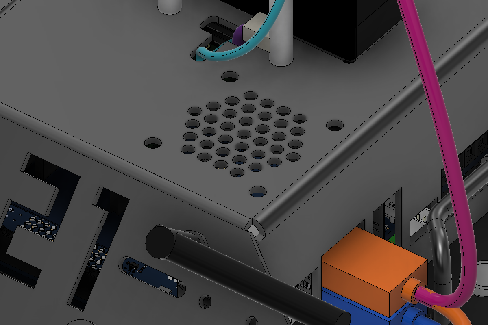
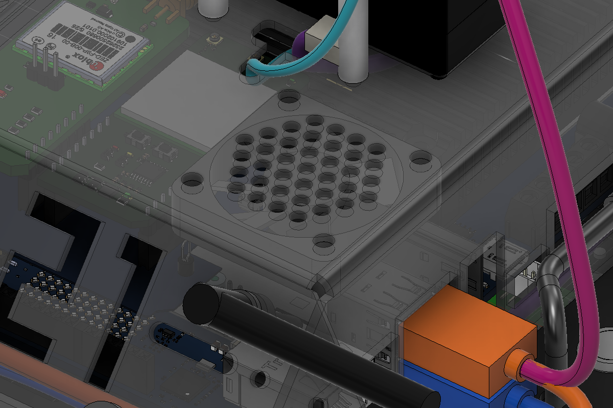
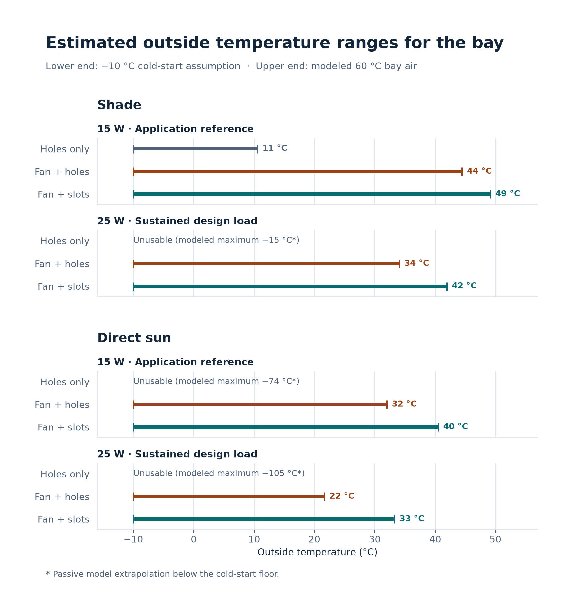

# BJ-STU-002 - Ventilation study for the VENTUNO Q enclosure

| | |
|---|---|
| Document | BJ-STU-002 |
| Revision | C |
| Date | 15 November 2026 |
| Status | Design analysis; hardware validation pending |
| Project | Blackjack Rover: rover for the Arduino VENTUNO Q on a Waveshare UGV02 chassis |
| Licence | CC BY 4.0, credit: Blackjack Rover by Alessandro Pistella, github.com/alepistella/blackjack |

## 1. Purpose

I first had the perforated cover assessed without a bay fan. The predicted temperature rise was too high, so I had the same cover recalculated with a 40 mm fan. That gave enough airflow in shade, but the heat entering through the black cover in direct sun cut the margin at 25 W. The third calculation kept the fan and replaced the holes above it with seven slots. That is the layout I adopted for the BJ-P02 cover.

The study uses 60 °C, the board's upper operating temperature rating, as a limit for the air around its heatsink. The results are steady-state estimates used to select the cover geometry. The temperature at the heatsink inlet and the behaviour of the SoM under sustained load still need to be checked on the rover.

## 2. Sources

| ID | Source | Used for |
|---|---|---|
| SRC-01 | [Arduino VENTUNO Q data sheet ABX00181](https://docs.arduino.cc/resources/datasheets/ABX00181-datasheet.pdf), 62 pages, "Modified: 12/11/2026": ratings table, power consumption table, section 12.1 "SoM Heatsink & Thermal Design" | heat to remove, temperature rating |
| SRC-N07 | Noctua, [NF-A4x10 5V PWM specifications](https://www.noctua.at/en/products/nf-a4x10-5v-pwm/specifications), read on 15 November 2026 (page not archived) | fan end points and temperature rating |
| RIL-084, RIL-085 | Measurements on the CAD model, Fusion document "Blackjack_B", 15 November 2026 | free areas of the openings with holes and with slots, surface of the cover |
| [1] | I. E. Idelchik, Handbook of Hydraulic Resistance, perforated plates and orifices (working reference) | loss coefficient assumption |

Third-party documents are cited, not reproduced. Identifiers RIL-nnn and D-nnn refer to the measurement and decision registers of the project.

## 3. Inputs

### 3.1 Heat to remove

| Condition of the VENTUNO Q | Power | Source |
|---|---|---|
| Average, "Edge AI Assistant" example | 13.5 W | SRC-01, power table at 12 V, measured by Arduino at 24.4 °C ambient |
| Average, "Smart Mirror" with USB camera, USB headset and HDMI display connected | 14.7 W | SRC-01, section 3.4.1, 12 V DC |
| Average, "Detect Objects on Smartphone Camera" | 9.63 W | SRC-01, section 3.4.1, 12 V DC |
| High sustained load with MPU, NPU and GPU running together at full performance | approximately 25 W or more | SRC-01, section 12.1, page 51 |
| Short peak, "Smart Mirror" | 33.0 W | SRC-01, section 3.4.1, 12 V DC |

The board is rated for operation from −10 to 60 °C (SRC-01, ratings table, symbol TOP). Its SoM has its own heatsink and fan. I chose 15 W as a reference for an active application based on Arduino's 13.5 W and 14.7 W averages at 12 V. The object detection example gives a lower reference of 9.63 W with a smartphone as the camera. On Blackjack, camera-based inference running alongside ROS 2 navigation is the workload to measure against the 15 W reference.

I used 25 W held continuously to size the ventilation. Arduino's thermal design guidance gives approximately 25 W or more with MPU, NPU and GPU active at full performance. In the model, both values are imposed as heat inside the bay. The actual heat budget has to account for the installed board, fan and peripherals that dissipate heat there. The bay fan is rated at up to 0.35 W (SRC-N07). The 33 W entry is the peak Arduino measured for Smart Mirror at 12 V.

### 3.2 Bay fan

Noctua NF-A4x10 5V PWM, 40 x 40 x 10 mm (SRC-N07): maximum air flow 8.9 m³/h, maximum static pressure 1.95 mm H2O (19.1 Pa), 5000 rpm, 19.6 dB(A), input power 0.35 W maximum. The manufacturer publishes these two end points and not the full curve.

### 3.3 Openings of the cover

Opening areas come from the `Blackjack_B` CAD model. RIL-084 records the perforated cover (BJ-P02 v0.31); RIL-085 records the slotted grille introduced in v0.32. Areas are the open cutouts in the sheet, before allowing for discharge losses.

| Opening | Geometry | Free area |
|---|---|---|
| Roof grille B, above the bay fan, with holes | 37 holes dia 3.5 mm at 5 mm pitch inside a 38 mm circle | 356 mm² |
| Roof grille B, with slots (cover v0.32) | 7 slots 3.5 mm wide, 2 mm apart, inside the same circle | 667 mm² |
| Roof grille A, above the heatsink | 37 circular holes in all three configurations | 356 mm² |
| Number 21, two side walls | digit "2" 315 mm² and digit "1" 170 mm² on each wall | 970 mm² |
| Front grille, inclined front wall | 16 slats 3.2 mm wide | 1258 mm² |
| Vent path other than grille B | A + 21 + front | 2584 mm² |

Excluded from the airflow calculation: the five connector openings of the rear wall (1978 mm² in the sheet, largely filled by connectors and plugs), the holes of the accessory row, the screw and cable holes, and every gap between cover and deck. Counting 400 mm² of free area at the rear wall changes the flow by less than 1% under the same loss assumptions, since most of the pressure drop is at grille B.

The sheet is 2 mm thick; the cover has 0.0526 m² of surface (body volume 105.13 cm³ divided by the thickness).

### 3.4 Air

Dry air at 30 °C and 101325 Pa: density 1.164 kg/m³ from the ideal gas law, specific heat 1007 J/(kg K).

## 4. Method

### 4.1 Energy balance

In the shade calculation, heat leaves with the outgoing air and through the sheet metal:

    P = (rho * cp * Q + U * A_wall) * (T_bay - T_out)

The model treats the bay as well mixed. It represents the air around the board by a single temperature and cannot resolve local hot spots.

### 4.2 Air flow: fan against vent path

The operating flow is where the fan pressure equals the vent path loss. The model puts two restrictions in series: grille B and the combined area of the intake openings in parallel. Each restriction is treated as an orifice:

    dp = (rho / 2) * (Q / (Cd * A))^2

Both grille geometries use Cd = 0.61, a sharp-edged orifice approximation [1]. This keeps the loss assumption the same when comparing the two free areas; the model does not resolve the detailed flow through each hole or slot.

The fan model uses two curves through the catalogue end points. The base curve is a straight line from 19.1 Pa at zero airflow to 8.9 m³/h at zero pressure. The lower curve, dp = dp_max (1 - Q/Q_max)^2, predicts less airflow through the same openings. Both curves are estimates from the catalogue end points. The thermal comparison uses the lower curve and gives the cover no credit for heat loss.

### 4.3 Heat through the sheet metal

Inside: forced convection of weak intensity, 5 W/(m² K). Outside: natural convection 5 W/(m² K) plus radiation of a painted surface (emissivity 0.9) at about 35 °C, 4 eps sigma T^3 = 6.0 W/(m² K). In series: U = 3.4 W/(m² K), U * A_wall = 0.18 W/K. The conduction resistance of 2 mm of metal is negligible. This path is used only where stated.

### 4.4 Direct sun

Full summer sun, 900 W/m², on a black cover (absorptance 0.9) with 0.046 m² of projected area: about 37 W absorbed. With 11 W/(m² K) towards the outside and 5 W/(m² K) towards the inside, about 30% goes inwards. The no-wind case uses 12 W, rounded up from that estimate. In the sun cases this heat is added to the heat of the board and the sheet-metal path of section 4.3 is set to zero.

### 4.5 No fan

Without the fan the flow is the buoyancy draught through inlets (front grille and number 21) and outlets (the two roof grilles) in series, with a height difference of 20 mm between them:

    A_eff = (1 / A_in^2 + 1 / A_out^2)^(-1/2)
    Q = Cd * A_eff * sqrt(2 * g * h * dT / T)

Here dT is the bay temperature rise, T is the reference air temperature in kelvin, and h is the height difference. Solve Q and dT together with the energy balance.

## 5. Configurations and results

### 5.1 Perforated cover without a bay fan

*Figure 1. Original cover with 37 holes at grille B and no bay fan. CAD view.*

The height difference between the inlet and outlet openings is only about 20 mm. At 15 W the buoyancy model gives 0.4 m³/h, raising the bay air about 50 K above ambient even in shade. The predicted rise is about 75 K at 25 W. This was enough to rule out passive ventilation for the perforated cover.

### 5.2 Fan under the perforated grille

*Figure 2. The 40 mm fan added below the original grille. CAD view.*

The next calculation kept all the openings and added the bay fan. Using the lower fan curve, the model gives about 3.0 m³/h. At 25 W, the resulting outside temperature threshold is 34 °C in shade and 22 °C in direct sun. The holes leave only 356 mm² open above the fan, about 31% of its 38 mm opening. Increasing that area gave a way to improve airflow while retaining the fan and its mount.

### 5.3 Fan under seven slots

*Figure 3. Seven slots above the same fan, with the original mounting pattern. CAD view.*

Seven 3.5 mm slots with 2 mm of sheet between them increase the free area from 356 to 667 mm². On the lower fan curve, the additional open area raises the calculated airflow from 3.0 to 4.2 m³/h.

*Figure 4. Where each fan curve crosses the corresponding vent-path curve, the pressure the fan supplies equals the pressure lost through the openings. Filled markers are the base estimates; open markers use the lower fan curve.*

### 5.4 Estimated outside temperature ranges for the bay

The temperature comparison uses one estimate for each configuration and condition. For the fan configurations, I used the lower fan curve because the installed airflow still has to be measured. I took the intersection of that curve and the vent-path pressure loss, then used that airflow to carry the full heat load, with no cooling credit for the cover. For direct sun I added the 12 W solar load from section 4.4. With holes alone, airflow comes from the buoyancy calculation in section 4.5, which includes heat loss through the cover in shade.

The lower end is −10 °C. I use the lower operating ratings of the VENTUNO Q (−10 to 60 °C, SRC-01) and the bay fan (−10 to 70 °C, SRC-N07) as a cold-start constraint, assuming that the bay and its equipment have been allowed to reach outdoor temperature before power-on. The upper end is the outside temperature at which the model puts the bay air at 60 °C. A range exists where the two constraints overlap. The table rounds the calculated upper end to the nearest degree.

| Configuration | 15 W, shade | 25 W, shade | 15 W, direct sun | 25 W, direct sun |
| --- | ---: | ---: | ---: | ---: |
| Holes only | −10 to 11 °C | Unusable (−15 °C*) | Unusable (−74 °C*) | Unusable (−105 °C*) |
| Fan + 37 holes | −10 to 44 °C | −10 to 34 °C | −10 to 32 °C | −10 to 22 °C |
| Fan + 7 slots | −10 to 49 °C | −10 to 42 °C | −10 to 40 °C | −10 to 33 °C |

\* In these cases the passive model requires an outside temperature below the cold-start floor. The numbers are extrapolations using air properties fixed at 30 °C.

*Figure 5. Estimated outside temperature ranges for the electronics bay, grouped by sun exposure. Each bar joins the cold-start design floor and the modeled upper threshold on a common scale.*

The complete rover's temperature range remains to be established. It depends on the selected cells and power electronics, the installed peripherals, and tests of the assembled rover at both ends of the range. Assess charging separately against the selected cells' charging limits.

## 6. Selected cover

The BJ-P02 cover uses seven slots at grille B with the 40 mm fan set to exhaust. At 25 W in the direct-sun case, the slots raise the conservative outside temperature estimate from 22 to 33 °C. Grille A above the heatsink stays perforated. It provides a path for incoming air along with the front grille and the **21** cutouts. The bay fan is intended to run whenever the board is powered. Records: D-093 (grille geometry) and D-094 (fan direction).

## 7. Model limits

The model assumes steady heat input, unobstructed vents and well-mixed air. The sun case represents a black cover at 900 W/m² with no wind. It does not describe changing sun angle, airflow around the moving rover or local temperatures under the roof. The fan curves and orifice losses are estimates. The actual airflow and temperature margin depend on the built enclosure and the heat released by the installed equipment.

## 8. Hardware verification

Start in shade with the assembled cover, and log outside air temperature, air temperature near the board heatsink inlet, sustained electrical load, SoM temperature and fan tachometer speed. Hold a representative workload and then a sustained load near the 25 W design case until temperatures settle. Compare the measured rise above ambient with the model at the recorded load. For the slotted cover in shade, the conservative calculation gives a rise of 10.8 K at 15 W and 18.1 K at 25 W. For airflow, take readings across grille B or use a flow fixture; a single velocity reading in a slot does not give the total flow.

To find the load the rover usually runs at, log VENTUNO Q input voltage and current during standby, teleoperation and a representative navigation run with camera inference. Record how much time the rover spends in each mode, the average power in each mode and any sustained high load. Use the same drive workload with inference enabled and disabled to isolate its contribution. Measure loads powered separately inside the bay as part of the heat budget. Compare the sustained readings with the 15 W reference and 25 W design load once the bay temperature has settled.

Repeat under direct sun with the same cover finish and record irradiance, orientation and wind so the run can be compared with the modeled case. For the conditions claimed, the inlet air must stay below 60 °C and the SoM must complete the workload without thermal throttling. Record the test conditions with the result.

## 9. Calculation

To reproduce the comparison, calculate the vent-path pressure drop from the areas in section 3.3 and intersect it with each fan curve by bisection. Use the resulting airflow in the energy balance for shade and for the additional 12 W sun load. For the passive case, solve the buoyancy flow and energy balance together.
