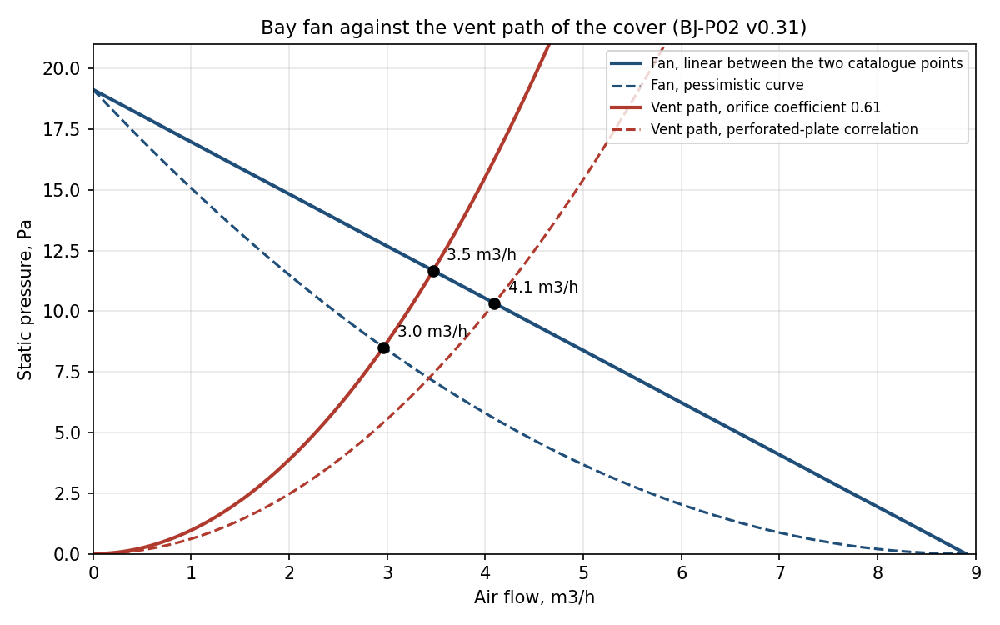

# BJ-STU-002 - Bay ventilation study: fan, vents and temperature of the VENTUNO Q bay

| | |
|---|---|
| Document | BJ-STU-002 |
| Revision | A |
| Date | 15 November 2026 |
| Status | Released for publication by Alessandro Pistella |
| Project | Blackjack Rover: rover for the Arduino VENTUNO Q on a Waveshare UGV02 chassis |
| Requested by | Alessandro Pistella |
| Prepared by | Alessandro Pistella, with AI agents working under written rules |
| Licence | CC BY 4.0, credit: Blackjack Rover by Alessandro Pistella, github.com/alepistella/blackjack |

## 1. Purpose

The cover of Blackjack Rover encloses the Arduino VENTUNO Q. This study shows that the ventilation designed into the cover (one 40 mm fan, two roof grilles, the front grille and the number 21 cut through the side walls) keeps the air around the board inside the temperature rating of the board, and with what margin.

**Result.** With the fan running, the vents pass 3.0 to 4.1 m3/h. At the worst-case power that Arduino states for the board, 25 W held continuously, the bay air stays below the 60 deg C rating up to 41 deg C outside (34 deg C under the most conservative set of assumptions). At the average power of a real workload, 15 W, the limit is 48 deg C outside (44 deg C most conservative). The ventilation as designed is sufficient.

## 2. Sources

| ID | Source | Used for |
|---|---|---|
| SRC-01 | Arduino VENTUNO Q data sheet ABX00181, 62 pages, "Modified: 12/11/2026": ratings table, power consumption table, section 12.1 "SoM Heatsink & Thermal Design" | heat to remove, temperature rating |
| SRC-N07 | Noctua, NF-A4x10 5V PWM specification page, noctua.at/en/products/fan/nf-a4x10-5v-pwm/specification, read on 15 November 2026 | fan end points |
| RIL-084 | Measurement on the CAD model, Fusion document "Blackjack_B" version 51, 15 November 2026 | free areas of the openings, surface of the cover |
| [1] | I. E. Idelchik, Handbook of Hydraulic Resistance, perforated plates and orifices | loss coefficients |

Third-party documents are cited, not reproduced. Identifiers RIL-nnn and D-nnn refer to the measurement and decision registers of the project.

## 3. Inputs

### 3.1 Heat to remove

| Condition of the VENTUNO Q | Power | Source |
|---|---|---|
| Average, "Edge AI Assistant" example | 13.5 W | SRC-01, power table at 12 V, measured by Arduino at 24.4 deg C ambient |
| Average, "Smart Mirror" example | 14.7 W | same |
| Worst case, MPU, NPU and GPU together at full performance | about 25 W | SRC-01, section 12.1, page 51 |
| Highest instantaneous value in the table | 33.0 W | SRC-01, power table at 12 V |

The board is rated for operation from -10 to 60 deg C (SRC-01, ratings table, symbol TOP). Its SoM has its own heatsink and fan, sized by Arduino for the 25 W case (SRC-01, section 12.1). The cover therefore has one job: keep the air around the board below 60 deg C. The study uses five load cases: 15 W (average workload), 20 W, 25 W (worst case stated by Arduino, taken as continuous), 30 W and 33 W (the instantaneous maximum, taken as continuous, which it is not).

The bay fan adds 0.35 W at most (SRC-N07) and is included in the cases above.

### 3.2 Bay fan

Noctua NF-A4x10 5V PWM, 40 x 40 x 10 mm (SRC-N07): maximum air flow 8.9 m3/h, maximum static pressure 1.95 mm H2O (19.1 Pa), 5000 rpm, 19.6 dB(A), input power 0.35 W maximum. The manufacturer publishes these two end points and not the full curve.

### 3.3 Openings of the cover

Measured on the CAD model, body "BJ-P02 concept v0.31" of the Fusion document "Blackjack_B" version 51, by rebuilding every inner loop of every planar face as a face and reading its area (record RIL-084).

| Opening | Geometry | Free area |
|---|---|---|
| Roof grille B, above the bay fan | 37 holes dia 3.5 mm at 5 mm pitch inside a 38 mm circle | 356 mm2 |
| Roof grille A, above the heatsink | same | 356 mm2 |
| Number 21, two side walls | digit "2" 315 mm2 and digit "1" 170 mm2 on each wall | 970 mm2 |
| Front grille, inclined front wall | 16 slats 3.2 mm wide | 1258 mm2 |
| Vent path other than grille B | A + 21 + front | 2584 mm2 |

Left out on purpose, so that the result is on the safe side: the five connector openings of the rear wall (1978 mm2 in the sheet, largely filled by connectors and plugs), the holes of the accessory row, the screw and cable holes, and every gap between cover and deck. Counting 400 mm2 of free area at the rear wall changes the flow by less than 1 %, because grille B governs.

The sheet is 2 mm thick; the cover has 0.0526 m2 of surface (body volume 105.13 cm3 divided by the thickness).

### 3.4 Air

Dry air at 30 deg C and 101325 Pa: density 1.164 kg/m3 from the ideal gas law, specific heat 1007 J/(kg K).

## 4. Method

### 4.1 Energy balance

All the heat released in the bay leaves with the air that the fan moves, plus what crosses the sheet metal:

    P = (rho * cp * Q + U * A_wall) * (T_bay - T_out)

The bay is taken as well mixed (the heatsink fan of the board stirs it), so the temperature of the air that leaves is the temperature of the air around the board.

### 4.2 Air flow: fan against vent path

The flow is where the pressure the fan can give equals the pressure the path asks for. The path is two restrictions in series: grille B, which all the air crosses together with the fan, and the other openings in parallel. Each is treated as an orifice:

    dp = (rho / 2) * (Q / (Cd * A))^2

Two descriptions of grille B bracket the answer:

- conservative: sharp-edged orifice, Cd = 0.61, for every opening;
- expected: perforated-plate correlation of Idelchik for a thin plate, zeta = (0.707 (1 - f)^0.375 + 1 - f)^2 / f^2 on the approach velocity, with f = 356 / 1134 = 0.314 the free-area ratio over the 38 mm bore; it gives zeta = 17.2, equal to Cd = 0.77 on the free area. The plate is thicker than "thin" (t/d = 0.57), which lowers the loss further.

Two descriptions of the fan bracket it as well, since only the end points are published:

- straight line between 19.1 Pa at zero flow and 8.9 m3/h at zero pressure;
- pessimistic: dp = dp_max (1 - Q/Q_max)^2, which lies below the line everywhere.

### 4.3 Heat through the sheet metal

Inside: forced convection of weak intensity, 5 W/(m2 K). Outside: natural convection 5 W/(m2 K) plus radiation of a painted surface (emissivity 0.9) at about 35 deg C, 4 eps sigma T^3 = 6.0 W/(m2 K). In series: U = 3.4 W/(m2 K), U * A_wall = 0.18 W/K. The conduction resistance of 2 mm of metal is negligible. This path is used only where stated.

## 5. Results

### 5.1 Air flow

*Figure 1. Fan curves and vent-path curves; the dots are the three operating points. Own work, computed with the script archived with the record.*

| Case | Fan curve | Grille B | Flow | Pressure at the fan | Speed in the holes |
|---|---|---|---|---|---|
| Most conservative | pessimistic | Cd 0.61 | 3.0 m3/h | 8.5 Pa | 2.3 m/s |
| Base | straight line | Cd 0.61 | 3.5 m3/h | 11.7 Pa | 2.7 m/s |
| Expected | straight line | perforated-plate correlation | 4.1 m3/h | 10.3 Pa | 3.2 m/s |

The gross volume of the bay is about 2 litres, so even the lowest figure renews its air every two to three seconds.

### 5.2 Temperature of the bay air above the outside air

| Heat in the bay | Most conservative (air only) | Base (air and sheet metal) | Expected (air and sheet metal) |
|---|---|---|---|
| 15 W | 15.6 K | 11.5 K | 9.9 K |
| 20 W | 20.7 K | 15.3 K | 13.2 K |
| 25 W | 25.9 K | 19.1 K | 16.5 K |
| 30 W | 31.1 K | 22.9 K | 19.8 K |
| 33 W | 34.2 K | 25.2 K | 21.8 K |

### 5.3 Highest outside temperature that keeps the board inside its rating

Outside temperature at which the bay air reaches 60 deg C:

| Heat in the bay | Most conservative | Base | Expected |
|---|---|---|---|
| 15 W, average workload | 44 deg C | 48 deg C | 50 deg C |
| 20 W | 39 deg C | 45 deg C | 47 deg C |
| 25 W, worst case of the board held continuously | 34 deg C | 41 deg C | 43 deg C |
| 30 W | 29 deg C | 37 deg C | 40 deg C |
| 33 W, instantaneous maximum held continuously | 26 deg C | 35 deg C | 38 deg C |

*Figure 2. Outside temperature at which the bay air reaches the 60 deg C rating of the board, against the heat released in the bay. Own work.*

## 6. Reading of the results

1. **The vents are adequate for the board.** Arduino sized the heatsink and fan of the SoM for 25 W; the cover gives that cooler air below 60 deg C up to 41 deg C outside, and up to 34 deg C when every assumption is taken against the design at once.
2. **Grille B sets the flow.** The other openings together offer seven times its free area, so the number 21 and the front grille are not the restriction: they are the reason why the air enters low and at the front and leaves at the rear of the roof.
3. **The bay fan works as an extractor.** Fresh air then enters through the front grille, through the number 21 and through grille A, which sits directly above the heatsink fan of the board.
4. **Design rule.** The bay fan runs whenever the board is powered.

## 7. Assumptions

- Steady state, bay air well mixed, outside air at 30 deg C for the properties, sea-level pressure.
- No direct sunlight on the cover.
- Optional parts of the roof (lidar, turret) fitted on their own mounting pattern, clear of the two grilles (10 mm, RIL-043).

## 8. Bench test plan

| Item | What is measured |
|---|---|
| Bay air temperature | thermocouple above the board, at 15 W and at full load, fan on |
| Air flow | anemometer on grille B, compared with section 5.1 |
| SoM temperature | on-board sensor, against the throttling threshold |
| Fan speed control | PWM against bay temperature |

## 9. Reproduce it

The calculation is a short Python script: energy balance, two orifices in series, bisection on the fan curve. Inputs are the ones of section 3.
