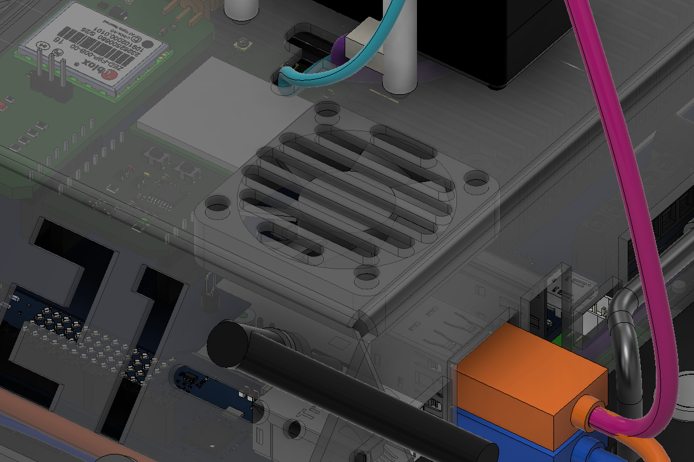

# BJ-STU-002 - Bay ventilation study: fan, vents and temperature of the VENTUNO Q bay

| | |
|---|---|
| Document | BJ-STU-002 |
| Revision | B |
| Date | 15 November 2026 |
| Status | Released for publication by Alessandro Pistella |
| Project | Blackjack Rover: rover for the Arduino VENTUNO Q on a Waveshare UGV02 chassis |
| Requested by | Alessandro Pistella |
| Prepared by | Alessandro Pistella, with AI agents working under written rules |
| Licence | CC BY 4.0, credit: Blackjack Rover by Alessandro Pistella, github.com/alepistella/blackjack |

## 1. Purpose

The cover of Blackjack Rover encloses the Arduino VENTUNO Q. This study shows that the ventilation designed into the cover (one 40 mm fan under a slotted roof vent, a second roof grille, the front grille and the number 21 cut through the side walls) keeps the air around the board inside the temperature rating of the board, and with what margin.

**Result.** Three configurations are compared: vents only, a fan under a grille with holes, the same fan under slots. Vents alone leave the bay air 50 K above the outside air. The fan under holes passes 3.5 m3/h and is sufficient in shade. The fan under slots, which is the design, passes 5.2 m3/h: at the worst-case power of the board, 25 W held continuously, the air around the board stays inside its 60 deg C rating up to 47 deg C outside in shade and 38 deg C in direct summer sun.

## 2. Sources

| ID | Source | Used for |
|---|---|---|
| SRC-01 | Arduino VENTUNO Q data sheet ABX00181, 62 pages, "Modified: 12/11/2026": ratings table, power consumption table, section 12.1 "SoM Heatsink & Thermal Design" | heat to remove, temperature rating |
| SRC-N07 | Noctua, NF-A4x10 5V PWM specification page, noctua.at/en/products/fan/nf-a4x10-5v-pwm/specification, read on 15 November 2026 | fan end points |
| RIL-084, RIL-085 | Measurements on the CAD model, Fusion document "Blackjack_B", 15 November 2026 | free areas of the openings with holes and with slots, surface of the cover |
| [1] | I. E. Idelchik, Handbook of Hydraulic Resistance, perforated plates and orifices | loss coefficients |

Third-party documents are cited, not reproduced. Identifiers RIL-nnn and D-nnn refer to the measurement and decision registers of the project.

## 3. Inputs

### 3.1 Heat to remove

| Condition of the VENTUNO Q | Power | Source |
|---|---|---|
| Average, "Edge AI Assistant" example | 13.5 W | SRC-01, power table at 12 V, measured by Arduino at 24.4 deg C ambient |
| Average, "Smart Mirror" example | 14.7 W | same |
| Worst case, MPU, NPU and GPU together at full performance | about 25 W | SRC-01, section 12.1, page 51 |
| Highest instantaneous value in the table | 33.0 W | SRC-01, power table at 12 V |

The board is rated for operation from -10 to 60 deg C (SRC-01, ratings table, symbol TOP). Its SoM has its own heatsink and fan, sized by Arduino for the 25 W case (SRC-01, section 12.1). The cover therefore has one job: keep the air around the board below 60 deg C. The study uses five load cases: 15 W (average workload), 20 W, 25 W (worst case stated by Arduino, taken as continuous), 30 W and 33 W (the instantaneous maximum, taken as continuous, which it is not).

The bay fan adds 0.35 W at most (SRC-N07) and is included in the cases above.

### 3.2 Bay fan

Noctua NF-A4x10 5V PWM, 40 x 40 x 10 mm (SRC-N07): maximum air flow 8.9 m3/h, maximum static pressure 1.95 mm H2O (19.1 Pa), 5000 rpm, 19.6 dB(A), input power 0.35 W maximum. The manufacturer publishes these two end points and not the full curve.

### 3.3 Openings of the cover

Measured on the CAD model, body "BJ-P02 concept v0.31" of the Fusion document "Blackjack_B" version 51, by rebuilding every inner loop of every planar face as a face and reading its area (records RIL-084 and RIL-085).

| Opening | Geometry | Free area |
|---|---|---|
| Roof grille B, above the bay fan, with holes | 37 holes dia 3.5 mm at 5 mm pitch inside a 38 mm circle | 356 mm2 |
| Roof grille B, with slots (cover v0.32) | 7 slots 3.5 mm wide, 2 mm apart, inside the same circle | 667 mm2 |
| Roof grille A, above the heatsink | same | 356 mm2 |
| Number 21, two side walls | digit "2" 315 mm2 and digit "1" 170 mm2 on each wall | 970 mm2 |
| Front grille, inclined front wall | 16 slats 3.2 mm wide | 1258 mm2 |
| Vent path other than grille B | A + 21 + front | 2584 mm2 |

Left out on purpose, so that the result is on the safe side: the five connector openings of the rear wall (1978 mm2 in the sheet, largely filled by connectors and plugs), the holes of the accessory row, the screw and cable holes, and every gap between cover and deck. Counting 400 mm2 of free area at the rear wall changes the flow by less than 1 %, because grille B governs.

The sheet is 2 mm thick; the cover has 0.0526 m2 of surface (body volume 105.13 cm3 divided by the thickness).

### 3.4 Air

Dry air at 30 deg C and 101325 Pa: density 1.164 kg/m3 from the ideal gas law, specific heat 1007 J/(kg K).

## 4. Method

### 4.1 Energy balance

All the heat released in the bay leaves with the air that the fan moves, plus what crosses the sheet metal:

    P = (rho * cp * Q + U * A_wall) * (T_bay - T_out)

The bay is taken as well mixed (the heatsink fan of the board stirs it), so the temperature of the air that leaves is the temperature of the air around the board.

### 4.2 Air flow: fan against vent path

The flow is where the pressure the fan can give equals the pressure the path asks for. The path is two restrictions in series: grille B, which all the air crosses together with the fan, and the other openings in parallel. Each is treated as an orifice:

    dp = (rho / 2) * (Q / (Cd * A))^2

Two descriptions of grille B bracket the answer:

- conservative: sharp-edged orifice, Cd = 0.61, for every opening;
- expected, for the holes only: perforated-plate correlation of Idelchik for a thin plate, zeta = (0.707 (1 - f)^0.375 + 1 - f)^2 / f^2 on the approach velocity, with f = 356 / 1134 = 0.314 the free-area ratio over the 38 mm bore; it gives zeta = 17.2, equal to Cd = 0.77 on the free area. The plate is thicker than "thin" (t/d = 0.57), which lowers the loss further.

Two descriptions of the fan bracket it as well, since only the end points are published:

- straight line between 19.1 Pa at zero flow and 8.9 m3/h at zero pressure;
- pessimistic: dp = dp_max (1 - Q/Q_max)^2, which lies below the line everywhere.

### 4.3 Heat through the sheet metal

Inside: forced convection of weak intensity, 5 W/(m2 K). Outside: natural convection 5 W/(m2 K) plus radiation of a painted surface (emissivity 0.9) at about 35 deg C, 4 eps sigma T^3 = 6.0 W/(m2 K). In series: U = 3.4 W/(m2 K), U * A_wall = 0.18 W/K. The conduction resistance of 2 mm of metal is negligible. This path is used only where stated.

### 4.4 Direct sun

Full summer sun, 900 W/m2, on a black cover (absorptance 0.9) with 0.046 m2 of projected area: about 37 W absorbed. With 11 W/(m2 K) towards the outside and 5 W/(m2 K) towards the inside, about 30 % goes inwards: 12 W, taken with no wind. In the sun cases this heat is added to the heat of the board and the sheet-metal path of section 4.3 is set to zero.

### 4.5 No fan

Without the fan the flow is the buoyancy draught through inlets (front grille and number 21) and outlets (the two roof grilles) in series, with a height difference of 20 mm between them: Q = Cd * A_eff * sqrt(2 g h dT / T), solved together with the energy balance.

## 5. Three configurations, one after the other

The design did not start with a fan and slots. It got there in three steps, and the numbers of each step are the reason for the next.

### 5.1 Configuration 1: vents only, no fan

*Figure 3. Roof grille B with 37 holes of 3.5 mm, nothing underneath. CAD view, own work.*

Two roof grilles with holes, the front grille and the number 21, and no bay fan: the air moves only because warm air is lighter. The openings are about 20 mm apart in height, so the draught is weak: 0.4 m3/h at 15 W. The bay air settles about 50 K above the outside air at 15 W and about 75 K at 25 W. The board stays inside its rating only below 11 deg C outside at average load, and not at all at full load. Passive vents are not enough: the bay needs a fan.

### 5.2 Configuration 2: a fan under the holes

*Figure 4. The 40 mm fan under grille B with holes; the cover is shown translucent. CAD view, own work.*

With the fan under the same grille the flow rises about nine times, to 3.5 m3/h (3.0 with the pessimistic fan curve). At 15 W the bay air is 11.5 K above the outside air, at 25 W 19.1 K. In shade this is sufficient: 25 W held continuously up to 41 deg C outside.

The same figures show where the limit is. The 37 holes leave 356 mm2 free, 31 % of the bore of the fan, and the fan delivers only 40 % of its free flow: the grille, not the fan, sets the flow. In direct sun, where the black cover brings about 12 W more into the bay, the margin at full load goes down to 27 deg C outside.

### 5.3 Configuration 3: the fan under slots

*Figure 5. The same fan under seven slots; the cover is shown translucent. CAD view, own work.*

The holes become seven slots 3.5 mm wide with 2 mm of sheet between them, inside the same 38 mm circle and parallel to the slats of the front grille. The free area goes from 356 to 667 mm2 (59 % of the bore) with the same fan and the same screw pattern. The flow rises to 5.2 m3/h (4.3 with the pessimistic curve). At 25 W the bay air is 13.3 K above the outside air.

*Figure 1. Fan curves and vent-path curves for holes and for slots; the dots are the operating points in m3/h. Own work.*

### 5.4 Admissible outside temperature, in shade and in direct sun

Outside temperature at which the air around the board reaches its 60 deg C rating. Base case first; in brackets the same with the pessimistic fan curve and no help from the sheet metal.

| Configuration | Air flow | 15 W, shade | 15 W, direct sun | 25 W, shade | 25 W, direct sun |
|---|---|---|---|---|---|
| 1. Vents only, no fan | 0.4 m3/h | 11 deg C | outside the rating | outside the rating | outside the rating |
| 2. Fan under 37 holes | 3.5 m3/h | 49 deg C (44) | 36 deg C (32) | 41 deg C (34) | 27 deg C (22) |
| 3. Fan under 7 slots | 5.2 m3/h | 52 deg C (49) | 44 deg C (40) | 47 deg C (42) | 38 deg C (33) |

15 W is the average of a real workload; 25 W is the worst case stated by Arduino for the board, taken as continuous. "Direct sun" is full summer sun on the black cover with no wind: about 12 W more in the bay, and no heat leaving through the sheet metal (section 4.4).

Temperature of the bay air above the outside air, base case:

| Configuration | 15 W, shade | 15 W, direct sun | 25 W, shade | 25 W, direct sun |
|---|---|---|---|---|
| 1. Vents only, no fan | 50 K | above 100 K | 75 K | above 100 K |
| 2. Fan under 37 holes | 11.5 K | 23.9 K | 19.1 K | 32.8 K |
| 3. Fan under 7 slots | 8.0 K | 15.9 K | 13.3 K | 21.7 K |

*Figure 2. Outside temperature at which the bay air reaches 60 deg C, against the heat released by the board, for the three configurations. Dashed: direct sun. Own work.*

## 6. Why the fan, and why the slots

1. **The fan is there because the numbers ask for it.** Without it the bay air runs 50 K above the outside air at average load (configuration 1). With it, 8 to 12 K.
2. **The slots are there because the grille was the restriction, not the fan.** Opening the grille from 31 % to 59 % raises the flow by half with the same fan, the same noise and the same power, and costs only laser path.
3. **The slots are what makes the rover usable in the sun.** At full load the admissible outside temperature in direct sun goes from 27 to 38 deg C; at average load from 36 to 44 deg C.
4. **The other openings are not the restriction.** The front grille, the number 21 and the second roof grille together offer almost four times the free area of the slots: they are where the fresh air comes in, low and at the front.
5. **Design rules that follow.** The bay fan extracts, and runs whenever the board is powered.

## 7. Assumptions

- Steady state, bay air well mixed, outside air at 30 deg C for the properties, sea-level pressure.
- Direct sun: 900 W/m2, no wind, black finish; with wind or a lighter finish the sun cases improve.
- Optional parts of the roof (lidar, turret) fitted on their own mounting pattern, clear of the two grilles (10 mm, RIL-043).

## 8. Bench test plan

| Item | What is measured |
|---|---|
| Bay air temperature | thermocouple above the board, at 15 W and at full load, fan on |
| Air flow | anemometer on grille B, compared with section 5.3 |
| SoM temperature | on-board sensor, against the throttling threshold |
| Fan speed control | PWM against bay temperature |

## 9. Reproduce it

The calculation is a short Python script: energy balance, two orifices in series, bisection on the fan curve. Inputs are the ones of section 3.
